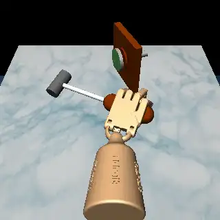

# Adroit hand suite

12 dexterous-manipulation tasks adapted from the Adroit hand environments as shipped in Farama's [Gymnasium-Robotics](https://robotics.farama.org/envs/adroit_hand/) (`AdroitHandDoor-v1`, `AdroitHandHammer-v1`, `AdroitHandPen-v1`, `AdroitHandRelocate-v1`; gymnasium-robotics 1.4.2, gymnasium 1.3.0, MuJoCo 3.3.0). The environments come from DAPG ("Learning Complex Dexterous Manipulation with Deep Reinforcement Learning and Demonstrations", Rajeswaran, Kumar, Gupta, Vezzani, Schulman, Todorov, Levine, 2018): the 24-joint ADROIT hand (Vikash Kumar's Shadow-style hand model) on a small arm opens a latched door, drives a nail with a hammer, turns a pen in the hand, and carries a ball to a point in the air. Three tasks per environment, each from a different start state.

Backend: `src/robouse/backends/adroit.py` (action interface, skills, observation, success, demo-replay reference solution). Generator: `python adapters/adroit/generate.py --out tasks/adroit` (downloads the four Minari files below once, 18 MB, into `~/.cache/robouse/minari-d4rl-human-v2`; needs `h5py`). It runs in-process in the main environment: `gymnasium-robotics` 1.4.2 must be installed where `robouse serve` runs.

## Source and licence

- Code: [Farama-Foundation/Gymnasium-Robotics](https://github.com/Farama-Foundation/Gymnasium-Robotics), MIT (`LICENSE`, "Copyright (c) 2022 Farama Foundation").
- Assets: `envs/assets/adroit_hand/`. Every model file carries "Copyright :: Vikash Kumar, Licensed under Apache License, Version 2.0" (the [ADROIT](https://github.com/vikashplus/Adroit) models, Apache-2.0); `envs/assets/LICENSE.md` repeats the Apache-2.0 notice for Vikash Kumar's hand models.
- Start states and reference actions: Farama's Minari datasets `D4RL/{door,hammer,pen,relocate}/human-v2` (Hugging Face [`farama-minari/D4RL`](https://huggingface.co/datasets/farama-minari/D4RL), pinned revision `a0fd465d1d9d253b075d532b270e03d8fb4f46e6`): the 25 human teleoperation demonstrations per environment from the [DAPG repository](https://github.com/aravindr93/hand_dapg) (Apache-2.0), re-recorded in `AdroitHand*-v1`. D4RL's datasets are licensed CC BY 4.0 ("Unless otherwise noted, all datasets are licensed under the Creative Commons Attribution 4.0 License", D4RL README). Each task stores only the demonstration's initial state (in `task.md`, `robouse.init_state`) and its actions (`oracle/demo.json`, rounded to 5 decimals).
- Hub dataset: `farama-foundation/adroit-hand` (the GitHub org of Gymnasium-Robotics, which ships these environments and the Minari datasets).

## Tasks

| Task id | Upstream env | Minari human-v2 episode | Start state | Step budget | Oracle steps |
|---|---|---|---|---|---|
| adroit-door-e11 | AdroitHandDoor-v1 | 11 | door frame at (-0.293, 0.322, 0.369) | 1000 | 236 |
| adroit-door-e18 | AdroitHandDoor-v1 | 18 | door frame at (-0.113, 0.256, 0.281) | 1000 | 257 |
| adroit-door-e23 | AdroitHandDoor-v1 | 23 | door frame at (-0.168, 0.359, 0.291) | 1000 | 226 |
| adroit-hammer-e14 | AdroitHandHammer-v1 | 14 | nail board at height 0.113 | 1500 | 484 |
| adroit-hammer-e18 | AdroitHandHammer-v1 | 18 | nail board at height 0.172 | 1500 | 467 |
| adroit-hammer-e19 | AdroitHandHammer-v1 | 19 | nail board at height 0.230 | 1500 | 390 |
| adroit-pen-e1 | AdroitHandPen-v1 | 1 | start similarity to the goal -0.71 | 600 | 200 |
| adroit-pen-e7 | AdroitHandPen-v1 | 7 | start similarity -0.25 | 600 | 200 |
| adroit-pen-e11 | AdroitHandPen-v1 | 11 | start similarity 0.03 | 600 | 200 |
| adroit-relocate-e0 | AdroitHandRelocate-v1 | 0 | ball (0.196, -0.169), target (0.168, -0.142, 0.160) | 1500 | 352 |
| adroit-relocate-e5 | AdroitHandRelocate-v1 | 5 | ball (0.068, 0.297), target (0.034, -0.181, 0.250) | 1500 | 527 |
| adroit-relocate-e17 | AdroitHandRelocate-v1 | 17 | ball (0.134, -0.052), target (-0.197, -0.189, 0.126) | 1500 | 378 |

Each task starts from the recorded initial state of one demonstration, restored with the env's own `reset(options={"initial_state_dict": ...})` / `set_env_state` (the same mechanism Minari records). The upstream randomisation (door position; nail-board height; pen goal orientation; ball and target positions) is thereby fixed per task. Episodes were chosen where (a) replaying the demonstration in gymnasium-robotics 1.4.2 / MuJoCo 3.3.0 ends in success and still succeeds after 10 more steps of holding, (b) holding the start targets never succeeds, and (c) the three start states of an environment differ. Of the 25 demonstrations per environment, the replay ends in success for 6 (door), 6 (hammer), 19 (pen) and 25 (relocate); many human demonstrations for door and hammer never succeed or only succeed in passing. One step is the upstream 10 ms (5 physics steps of 2 ms); the budgets are 3 to 7.5 times the upstream 200-step horizon (`max_episode_steps` of all four envs) and 3 to 4 times the demonstration length, because an agent works through a CLI and the skills move at human speed.

## Action and skills

The upstream action is one absolute position target per actuator, normalised to [-1, 1] over the actuator's control range. Door has 28 actuators (arm ARTz, ARRx, ARRy, ARRz; wrist WRJ1, WRJ0; 22 finger joints), Hammer 26 (arm ARRx, ARRy), Pen 24 (no arm) and Relocate 30 (arm ARTx, ARTy, ARTz, ARRx, ARRy, ARRz).

- `robo act` takes one number per actuator, in upstream order: the change of that actuator's target this step, in rad (m for the ARTx/ARTy/ARTz slides). Targets are clipped to the actuator's range; all zeros holds them, which is also what the 10-step settle after `robo done` sends. This is the upstream control made incremental: the backend sends `(target / k - mid) / half_range` to the upstream `env.step`.
- Targets are expressed as the joint position each servo settles at. The upstream servos apply `gain * ctrl - k_bias * q`; for the hand gain = k_bias, but the arm servos use gain 500 and position feedback 200, so an arm joint settles at 2.5 x its raw control value. The backend scales by k = gain / k_bias so that targets and `joints` share units; `robo info` lists each actuator's range in these units.
- At the start the targets equal the current joint positions, plus, for the arm, the offset that holds it still against gravity (`qfrc_bias / k_bias`); without it the weak upstream arm servos let the hand sag onto the table as soon as the episode starts.
- Skills (`robo skill`, closed-loop, every step counted): `set NAME VALUE ... [steps=N]` ramps named targets to absolute values; `hand open|close|pinch [AMOUNT] [steps=N]` sets a finger synergy (close is the finger posture of the human demonstrations' ball grasps: J2 0.6, J1 1.0, J0 1.0 rad on the four fingers, the thumb across, scaled by AMOUNT); `wait [N]`; and, on Relocate only, `move_palm X Y Z [SPEED]`, which moves `palm_pos` along a straight line with the three slides and the forearm tilt ARRx (a weighted least-squares solve on the palm Jacobian, joints at a limit left out, integral action on the palm error against gravity sag, velocity damping because the arm servos ring). `move_palm` is Relocate-only because Door (one slide) and Hammer (no slides) cannot move the palm in three independent directions. `robo move-to` and `robo grip` are disabled (a 24-joint hand has no single gripper command).

## Observation

`palm_pos` (the upstream `S_grasp` site, where a held object sits), `fingertips` (the five `S_*tip` sites), `joints` and `targets` (per actuator), and per environment:

| Env | Fields |
|---|---|
| Door | `handle_pos` (`S_handle`), `door_hinge`, `latch`, `door_open` |
| Hammer | `hammer_pos`, `hammer_rot` (Euler xyz), `hammer_head_pos` (`tool`), `nail_pos` (`S_target`), `nail_goal_pos` (`nail_goal`), `nail_goal_distance` |
| Pen | `pen_pos`, `pen_dir`, `target_dir` (unit vectors from the upstream top/bottom sites), `orientation_similarity`, `pen_home_pos` (`eps_ball`), `pen_home_distance` |
| Relocate | `ball_pos`, `target_pos`, `ball_target_distance` |

All are the quantities the upstream observation vector and reward are built from.

## Camera

320x320 renders from the upstream `fixed` camera (above the table, looking along +y), shadows and multisampling off (software rendering in the hub's simulator image is several times slower with them). The video records every 5th step (`frame_every: 5`, 50 ms of simulated time per frame).

## Success

The env's own `info["success"]` from the last step, unchanged: Door `door_hinge >= 1.35`; Hammer nail head within 0.01 m of `nail_goal`; Pen `orientation_similarity > 0.95` and pen within 0.075 m of `eps_ball`; Relocate ball within 0.1 m of the target. `success_mode: final`: judged after `robo done` and 10 steps of holding the targets. DAPG's evaluation counts an episode as a success when the goal holds for a number of steps during the episode; requiring it at the end after a hold is at least as strict.

## Reference solutions

`oracle_main(path)` in the backend replays `oracle/demo.json` through the socket: for each recorded upstream action it converts the normalised absolute targets to the task's units (from the ranges in `robo info`), reads the current `targets` from the last `robo act` reply and sends the difference. The observation rounds targets to 4 decimals; replays were checked to be insensitive to that (all 27 successful door, hammer and pen replays tested kept their outcome with the target changes rounded to 1e-4). The reference solutions do not use the skills; a scripted run of the skills on adroit-relocate-e0 (`hand open`, `move_palm` above the ball, down to ball height 2 cm on its -y side, `hand close`, `move_palm` up and to the target) succeeded in 873 steps.

## Validation

Through the real runner (`robouse run-many`, macOS, the shared dev venv):

| Harness | Run folder | Result |
|---|---|---|
| oracle | `runs/adroit-oracle` | 12/12 solved (200 to 527 steps; 7 to 9 s of wall time per episode) |
| noop | `runs/adroit-noop` | 0/12 solved |

In Docker with the hub runtime `base`: RESULTS_DOCKER.

## Model probe

Claude Code harness with Kimi K3 on Baseten (`claude-code-glm --model moonshotai/Kimi-K3`), `task-lists/adroit-probe.txt`: PROBE_SCORE.

PROBE_TABLE

## What was left out and why

- The `-v1` dense rewards of Door, Hammer and Relocate changed in gymnasium-robotics 1.2.1 without a version bump (gymnasium-robotics warns about it at import). Only `info["success"]` is used here, which did not change, so this does not affect scoring.
- Expert datasets (`expert-v2`, 5000 policy rollouts per env, 340 to 580 MB each) were not used: the human demonstrations are small and their replays succeed.
- A scripted (non-replay) reference solution was written only as a check for Relocate; Door, Hammer and Pen use demonstration replay. A replay depends on the simulator version: rerun `--harness oracle` after any MuJoCo or gymnasium-robotics upgrade.
- The sparse-reward (`AdroitHand*Sparse-v1`) and dense variants have the same success signal, so no separate tasks were made for them.
