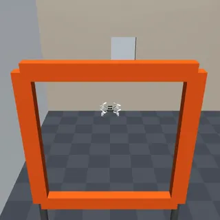

# Crazyflie suite (nano-quadrotors in a flight arena)

The crazyflie suite has 7 tasks in `tasks/crazyflie/`: five single-drone flights (one without skills) and two three-drone swarm tasks.

- Backend: `src/robouse/backends/crazyflie.py` (scene, controller, skills, monitor, judge, reference solutions).
- Generator: `python adapters/crazyflie/generate.py`.
- Shared embodiment base: `src/robouse/backends/embodied.py` (see [Embodiment suites](#embodiment-declaration)).

## Model and licence

The drone is the Bitcraze Crazyflie 2 from MuJoCo Menagerie (`bitcraze_crazyflie_2`, MIT), pinned at commit `8161bba2...`. It is fetched with `robouse fetch-assets --robot bitcraze_crazyflie_2`; hashes are in `assets/menagerie/embodiments.json`. The upstream mass (27 g), inertia, meshes, 32 convex collision hulls and thrust actuator (0-0.35 N) are kept.

One change: the upstream README says the actuator limits "are currently arbitrary". With the upstream moment limits (gear 1e-5 N m, ctrlrange +-1) the drone gets about 0.4 rad/s² of roll authority, roughly 300 times less than the real vehicle, and cannot hold attitude against small disturbances. The backend widens the moment ctrlrange to +-300 for roll and pitch (3 mN m) and +-100 for yaw (1 mN m), close to a Crazyflie 2.1's motor-arm authority.

## Scene

An indoor arena, 8 m x 6 m and 3 m high, with walls and a ceiling. World frame: +x east, +y north, +z up.

- A full-height partition at x = 1.5 splits it into a west hall and an east room. The only opening is a 0.36 m square window centred at (1.5, 1.8, 1.0).
- West hall: `home` pad, teal pad `A`, three racing gates (0.5 m openings, orange frames on posts) and the swarm pads `S0`, `S1`, `S2`.
- East room: yellow pad `B` and a 0.9 m shelf with a 0.3 m white landing platform.

All positions are public under `arena` in `robo observe`.

## Action and controller

One step is 50 ms (25 physics steps of 2 ms, RK4).

| Tasks | Action groups | Values |
|---|---|---|
| single drone | `body.velocity_setpoint` [VX, VY, VZ, YAW_RATE] | each in [-1, 1]: x 1 m/s (world frame), x 90 deg/s |
| swarm | `cf0.velocity_setpoint`, `cf1.velocity_setpoint`, `cf2.velocity_setpoint`, [VX, VY, VZ] each | x 1 m/s; headings fixed |

The controller runs at every physics step, per drone, in the style of the Crazyflie firmware's cascade:

1. Velocity error becomes a desired acceleration (gain 3 /s, horizontal limit 3 m/s²). An all-zero setpoint switches to position hold at the point where the drone would stop.
2. The acceleration plus gravity gives the thrust vector; with the commanded heading it gives the desired attitude.
3. A geometric attitude controller (Lee et al. 2010) computes the body moments, which drive the upstream moment actuators; the thrust drives `body_thrust`.
4. Landed state: touching the floor, a pad or the platform while not climbing switches the motors off until a command with VZ > 0.

## Skills

Single drone: `takeoff [Z]`, `goto X Y Z [TOL]`, `turn YAW_DEG`, `land`, `hover [SECONDS]`. Swarm: `takeoff_all [Z]`, `goto ID X Y Z [TOL]`, `goto_all X0 Y0 Z0 X1 Y1 Z1 X2 Y2 Z2 [TOL]`, `land ID`, `land_all`, `hover [SECONDS]`.

`goto` flies a straight line: it commands a velocity proportional to the distance between the target and the drone's predicted stopping point (position + 0.45 s x velocity), capped at 0.8 m/s horizontally. It does not avoid obstacles or other drones; route planning and deconfliction are the agent's job. Each skill yields ordinary actions, so its steps count against the budget.

## Observation and cameras

`robo observe` reports `drones` (per drone: `pos`, `vel`, `yaw_deg`, `roll_deg`, `pitch_deg`, `landed_on`, `motors_on`), `arena`, `progress` (waypoints reached, gates passed) and `safety_events`. Cameras: `cf0/chase` and `cf0/fpv` (single drone), `swarm` and a chase camera per drone (swarm tasks), `overview` and `east_room`.

## Tasks

| Task | Goal | Success (judged from the final state and the monitor) | Budget |
|---|---|---|---|
| crazyflie-waypoints | four waypoints in order, then land on `A` | each waypoint reached in order (centre within 0.10 m), resting on `A` | 1400 |
| crazyflie-gates | gates G1, G2, G3 in order and direction, then land on `A` | each gate plane crossed inside its opening, in order; resting on `A` | 1600 |
| crazyflie-window | through the window, land on `B` | resting on `B` | 1400 |
| crazyflie-window-manual | the same with skills disabled: `robo act` velocity setpoints only | resting on `B` | 1400 |
| crazyflie-shelf-landing | through the window, land on the shelf platform | resting on the platform | 1400 |
| crazyflie-swarm-formation | three drones into a 0.6 m equilateral triangle at 1.2 m, centred on (-1.9, -0.3) | heights within 0.05 m, centroid within 0.10 m, sides 0.6 +- 0.06 m, all slower than 0.1 m/s | 1200 |
| crazyflie-swarm-swap | swap cf0 and cf2 between `S0` and `S2`; cf1 ends on `S1` | all three resting on their target pads | 2000 |

"Resting" means touching the pad (or platform), slower than 0.1 m/s and tilted less than 20 degrees. In every task, any contact with something other than the floor, a pad or the platform is a crash and fails the task. In swarm tasks, two drones closer than 0.2 m (centre to centre) also fail it.

## Validation

Real runner, 2026-09-28, MuJoCo 3.3.0:

| Harness | Result | Runs |
|---|---|---|
| oracle | 7/7 | `runs/emb-oracle-crazyflie/` |
| noop | 0/7 | `runs/emb-noop-crazyflie/` |

The reference solutions use only the skills and public positions; the no-skills task's reference solution runs its own proportional controller through `robo observe` and `robo act`. Scripted wrong attempts score 0: flying straight at pad `B` crashes into the partition; passing G2 before G1 sets the out-of-order flag; swapping the swarm with one `goto_all` (straight, simultaneous lines) brings cf0 and cf2 into contact.

## Limitations

- There is no wind, no battery, no sensor noise and no downwash between drones; state is exact.
- The drones have no onboard obstacle sensing; the arena map is given as numbers.
- Crashes are detected from contacts only (walls, ceiling, gates, shelf sides, other drones).
- The fpv camera is a rendering convenience; the stock Crazyflie has no camera (the AI-deck add-on does).

## Embodiment declaration

Every embodiment backend declares one `Embodiment` (in `backends/embodied.py`): the robot and its Menagerie folders, its sensors (observation fields and cameras), the action groups that make up `robo act`, the skills with typed arguments, and the budget (control period, step limit). `robo info` shows it under `embodiment` in the format of BenchFlow's embodiment spec (spec_version 1: action groups with control modes and hold policies, sensors, typed skills, budgets), and each skill's signature under `skills`. Skills are generators that yield one action per control step, which the episode server runs as ordinary steps.
