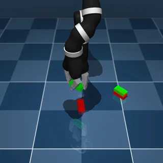

# dm_control suite (DeepMind Control Suite and Jaco manipulation)

The dm_control suite has 17 tasks in `tasks/dmcontrol/`, adapted from DeepMind's [dm_control](https://github.com/google-deepmind/dm_control) (Tassa et al., "dm_control: Software and Tasks for Continuous Control", 2020). Twelve come from the Control Suite (cart-pole, pendulum, acrobot, reacher, point mass, finger, ball in cup, planar manipulator), acted through each domain's own actuator commands; five come from `dm_control.manipulation` (a Kinova Jaco arm with the three-finger Jaco hand reaching, lifting, placing and stacking Duplo bricks), acted through an end-effector command. Every task is judged by its own "in target" condition (dm_control's sparse reward at 1), which must hold for a number of consecutive steps.

- Backend: `src/robouse/backends/dmcontrol.py` (task table, embodiment declarations, Jaco skills, judge, reference solutions).
- Simulator worker: `src/robouse/backends/dmcontrol_worker.py` (runs in dm_control's own virtualenv: environments, the Jaco end-effector controller, the success check, observation, rendering).
- Generator: `python adapters/dmcontrol/generate.py` (needs the dm_control virtualenv; it starts each task once to write its start state into the instruction).



## Source and licences

- Code and models: [google-deepmind/dm_control](https://github.com/google-deepmind/dm_control), Apache-2.0 ([LICENSE](https://github.com/google-deepmind/dm_control/blob/main/LICENSE)), PyPI release `dm-control==1.0.47`, which pins `mujoco==3.14.0` (Apache-2.0). The Control Suite models, the Duplo bricks and the arena ship inside the wheel.
- Kinova Jaco arm and hand models (`dm_control/third_party/kinova`): BSD-3-Clause, "Original work: Copyright (c) 2017, Kinova Robotics inc.; Modified work: Copyright (c) 2018, The dm_control Authors" ([LICENSE](https://github.com/google-deepmind/dm_control/blob/main/dm_control/third_party/kinova/LICENSE)). The wheel ships the models without that file; the notice is reproduced here.

Both licences allow redistribution and use in a public benchmark (keep the notices). Dataset: `google-deepmind/dm-control` (the GitHub organisation that published the benchmark, lowercased).

## Setup

dm_control 1.0.47 pins its own MuJoCo (3.14.0), newer than the Robo Use environment's (3.3.0), so it runs in its own virtualenv as a subprocess of the episode server that speaks JSON lines (the DexJoCo, driving and MyoSuite pattern).

```
uv venv -p 3.12 ~/.cache/robouse/dmcontrol-venv
uv pip install -p ~/.cache/robouse/dmcontrol-venv/bin/python dm-control==1.0.47
```

- The backend looks for `~/.cache/robouse/dmcontrol-venv/bin/python`; override with `ROBOUSE_DMCONTROL_PYTHON`. Set `ROBOUSE_DMCONTROL_QUIET=0` to see the worker's stderr. The full frozen environment is in the hub runtime (`templates/runtimes/dmcontrol/requirements-dmcontrol.txt` in robohub).
- Rendering: MuJoCo's default OpenGL backend on macOS; on Linux the worker sets `MUJOCO_GL=osmesa` (software rendering; the hub image installs `libosmesa6`).
- The worker loads Control Suite tasks with `suite.load(domain, task, task_kwargs={"random": seed, "time_limit": inf})` and manipulation tasks with `manipulation.load(name, seed=seed)` and an infinite time limit, so dm_control never ends an episode; the Robo Use step budget does.
- Speed: a whole reference-solution episode takes 6 to 20 s of wall time on an M2 Max (most of it process start-up and video encoding); the acrobot and ball-in-cup reference solutions spend a few seconds planning.

## Action

- **Control Suite tasks**: the domain's own actuator commands, each in [-1, 1], one step = the task's control timestep. Units per unit command: cart-pole 10 N on the cart (10 ms); pendulum 1 N m at the hinge (20 ms); acrobot 2 N m at the elbow (10 ms); reacher 0.05 N m at shoulder and wrist (20 ms); point mass 0.1 N along x and y (20 ms); finger 30 N m and 15 N m at the proximal and distal joints (20 ms); ball in cup 5 N on the cup along x and z (20 ms); planar manipulator 12, 8, 4, 2 N m at root, shoulder, elbow, wrist and 2 N on the finger tendon (10 ms). No skills (`skills: false`).
- **Jaco tasks** (40 ms steps): `DX DY DZ DYAW GRIP`. DX DY DZ in [-2, 2] move a commanded pinch point (dm_control's tool centre point, between the fingertips) by 1 cm per unit; DYAW in [-2, 2] turns the commanded hand yaw by 0.1 rad per unit. Every step the worker turns the command into the arm's six joint-velocity commands by damped least squares on the pinch site's 6-D Jacobian (position error plus the rotation error to "pointing down at the commanded yaw"). The command is clipped to the box x, y in [-0.35, 0.35], z in [-0.02, 0.6] m and to within 8 cm of the hand. GRIP in [-1, 1] sets the three fingers' velocity servos (3 rad/s at 1); at 0 the fingers stop and no longer squeeze. Skills: `move_to X Y Z [YAW] [GRIP]` (straight-line move of the commanded point at up to 2 cm per step, optional turn to YAW degrees, stops when within 6 mm or when the hand stops moving) and `grip VALUE [STEPS]`.
- **Hold value** (only used if an agent calls `robo done`, which ends the episode unsolved in these tasks): zeros.

## Observation

- Control Suite tasks: dm_control's own observation dict with its own key names (e.g. cart-pole `position` and `velocity`, reacher `position`, `to_target`, `velocity`, manipulator `arm_pos`, `arm_vel`, `touch`, `hand_pos`, `object_pos`, `object_vel`, `target_pos`), plus the named quantities an agent needs: joint angles and velocities by name, the positions of the tip, target, ball, cup, spinner and grasp sites in world coordinates (the planar domains in (x, z), reacher and point mass in (x, y)), the target radius and the current distance to the target.
- Jaco tasks: the pinch point and its commanded value, hand yaw and commanded yaw, the hand's pointing axis, arm and finger joint angles, each brick's position (centre of its bottom face), quaternion and yaw, plus per task the target site (reach), the brick's lowest corner and the target height (lift), the pedestal target, brick-to-target and hand-to-target distances (place), and the desired stacking order (stack).
- Every task: `reward` (dm_control's own reward for the last step), `in_target`, `hold_steps`, `hold_required`, `time_s`. Cameras: the domain's own (`fixed`, `lookatcart`, `lookat`, `cam0`, `cam1`, `hand`, `front_close`).

## Success

The task's own "in target" condition, computed by the worker from the physical state after every control step, must hold for `hold` consecutive steps; the episode ends as solved the moment it does (`success_mode: first`, like DexJoCo). `robo done` before that, giving up or running out of budget scores 0.

| Domain | Condition (dm_control source) |
|---|---|
| cart-pole | cart within 0.25 m of the centre and pole cosine >= 0.995 (`balance_sparse` / `swingup_sparse` reward) |
| pendulum | pole within 30 degrees of upright (the `swingup` reward, sparse by design) |
| acrobot | tip inside the 0.2 m target sphere at the top (`swingup_sparse` reward) |
| reacher | fingertip within target radius + finger radius of the target (reward) |
| point mass | mass within the 0.015 m target radius (the near-target factor of the reward; the full reward also scales by control effort) |
| finger | spinner tip inside the target circle (`dist_to_target <= 0`, reward) |
| ball in cup | ball entirely inside the cup (`in_target`, reward) |
| planar manipulator | ball within 1 cm of the target ball (`_is_close` at 1) |
| Jaco reach, lift, place, stack | the task's reward equal to 1: pinch point within 5 cm of the target; brick's lowest corner at least 0.3 m above its starting height; brick within 5 cm of the pedestal target and the hand at least 20 cm away; the summed stud-to-hole distance of two opposite corners below 1 mm |

Why a hold: dm_control scores these tasks per step over a fixed episode, so passing through the target once is worth little; requiring the condition for 0.2 to 8 s of simulated time turns them into clear pass/fail tasks (balance for 8 s, swing up and stay up, bring the ball and hold it there).

## Tasks

| Task id | Upstream task | Seed | Hold (steps, s) | Budget (steps) | Reference solution |
|---|---|---|---|---|---|
| dmcontrol-cartpole-swingup | cartpole swingup (sparse rule) | 1 | 200, 2 s | 1500 | energy-based swing-up, LQR balance |
| dmcontrol-cartpole-balance | cartpole balance (sparse rule) | 2 | 800, 8 s | 1000 | LQR |
| dmcontrol-pendulum-swingup | pendulum swingup | 9 | 100, 2 s | 1000 | energy pumping, LQR |
| dmcontrol-acrobot-swingup | acrobot swingup_sparse | 9 | 20, 0.2 s | 3000 | cross-entropy MPC on the acrobot model, LQR |
| dmcontrol-reacher-easy | reacher easy | 9 | 25, 0.5 s | 500 | two-link IK, joint PD |
| dmcontrol-reacher-hard | reacher hard | 0 | 25, 0.5 s | 500 | two-link IK, joint PD |
| dmcontrol-reacher-hard-b | reacher hard | 4 | 25, 0.5 s | 500 | two-link IK, joint PD |
| dmcontrol-point-mass-easy | point_mass easy | 9 | 25, 0.5 s | 500 | PD force control |
| dmcontrol-finger-turn-easy | finger turn_easy | 1 | 25, 0.5 s | 1000 | push the spinner with the fingertip (IK, joint PD) |
| dmcontrol-finger-turn-hard | finger turn_hard | 0 | 25, 0.5 s | 1000 | push the spinner with the fingertip (IK, joint PD) |
| dmcontrol-ball-in-cup-catch | ball_in_cup catch | 3 | 50, 1 s | 1000 | sampling MPC on a point-mass cup, ball and string model |
| dmcontrol-manipulator-bring-ball | manipulator bring_ball | 2 | 25, 0.25 s | 2000 | catch the rolling ball, grasp from above, carry (IK, joint PID) |
| dmcontrol-jaco-reach-site | reach_site_features | 4 | 10, 0.4 s | 300 | move_to |
| dmcontrol-jaco-lift-brick | lift_brick_features | 4 | 25, 1 s | 600 | grasp, lift (move_to, grip) |
| dmcontrol-jaco-place-brick | place_brick_features | 5 | 25, 1 s | 800 | grasp, carry, release, retract |
| dmcontrol-jaco-place-cradle | place_cradle_features | 2 | 25, 1 s | 800 | grasp, carry, release, retract |
| dmcontrol-jaco-stack-2-bricks | stack_2_bricks_features | 5 | 25, 1 s | 1000 | grasp, align the yaw, place, release, press from above |

Seeds (the upstream task's `random` seed, which fixes the layout, the target and the start pose) were chosen so that the start is not already in the target, doing nothing never reaches it, and the reference solution solves it with margin; several also start far from the goal (finger-turn-easy needs a 101 degree turn; acrobot and pendulum start hanging down).

## Reference solutions

All drive the robot only through the `robo` socket (`python -m robouse.oracle --backend dmcontrol`) and use only NumPy:

- Cart-pole: energy-based swing-up (pumping the pole's energy towards the upright value with a weak pull to the centre), then discrete LQR around the upright state (gains from a finite-difference linearisation of the dm_control model, hard-coded).
- Pendulum: bang-bang energy pumping, then LQR.
- Acrobot: the dm_control acrobot's motor (2 N m) is too weak for classic energy-based swing-up plus LQR: the LQR basin at the top is about 0.01 rad wide before the torque saturates. The reference solution plans with the cross-entropy method (64 samples, 3 iterations, 2 s horizon, 8 control knots, replanning every 40 ms) on the textbook acrobot equations with the dm_control parameters (RK4, verified against MuJoCo to 1e-4 over 3 s), minimising the tip's distance to the top plus the LQR cost-to-go at the horizon, and hands over to LQR inside its basin. From the task's start (hanging down, seed 9) 3 of 3 planner seeds reach the 0.2 s hold in 1065 to 1576 steps (seed 4: 3 of 3 in 991 to 2695); from the start of seed 1 one planner seed needed 2718 steps and two did not finish within 4000, which is why the task uses seed 9 and a 3000-step budget.
- Reacher: analytic two-link inverse kinematics, joint PD torques. Point mass: PD force.
- Finger: the spinner is heavily damped, so it turns only while pushed. The controller picks a point on the side of one spinner arm that the fingertip can reach (preferring pushes away from the finger's base, where the fingertip leads), approaches it from behind after first moving clear of the spinner, pushes it tangentially towards the goal angle (analytic IK, joint PD), and backs off once the tip is in the target. The fingertip cannot reach a spinner arm pointing up or down near the hinge from the correct side, so some start/goal pairs have no push in the needed direction; the chosen seeds avoid them.
- Ball in cup: predictive-sampling MPC (128 samples, 0.6 s horizon) on a point-mass model of the spring-mounted cup, the ball and the string (an inextensible, inelastic tether; cup-ball contacts not modelled); it swings the ball over the rim and catches it. 3 of 3 planner seeds solve the task's seed in 200 to 360 steps.
- Planar manipulator: stands the open hand on the floor as a barrier to stop the rolling ball, grasps it from above (hand pointing down; 4-joint damped least-squares IK and joint PID torques), lifts it and carries it to the target, correcting by the ball's own offset.
- Jaco: `move_to` above the brick with the hand yaw across the brick's width, down, `grip`, a short lift that checks the brick came along (otherwise let go and retry), then per task: lift 0.4 m; carry over the pedestal target, lower, open, retract 0.3 m; or for stacking turn the hand so the carried brick's long side is parallel to the other brick's, lower onto it, open, close the empty hand and press the brick down from above until it clicks.

## Validation

Local runner (`robouse run-many`, macOS, M2 Max):

- Reference solutions: **17/17** (`runs/dmcontrol-oracle`), 60 to 1065 steps, 6 to 20 s wall time per episode.
- No-op control: **0/17** (`runs/dmcontrol-noop`); the development harness also ran every task's full budget with zero actions: 0/17.

Docker (robohub runtime `dmcontrol`, exported from a scratch robohub copy with `scripts/export.py`, run with `bench eval run --agent oracle`, bench 0.7.4, Colima linux/arm64, no network in the simulator container):

- Reference solutions: **17/17** in 9.8 min at concurrency 2 (26 to 177 s per task including container start; the first build of the image took about 100 s).
- No-op control (`google-deepmind/dm-control-noop-control`, reference solution replaced by `robo info; robo observe`): **0/2** on `dmcontrol-cartpole-balance` and `dmcontrol-jaco-reach-site`.
- Simulator image: 1.69 GB (python:3.12-slim-bookworm, OSMesa, the episode server's packages and the dm_control virtualenv with MuJoCo 3.14.0). All dm_control wheels have linux/aarch64 builds, so nothing is compiled.

## Model probe

Claude Code harness with Kimi K3 on Baseten (`--harness claude-code-glm --model moonshotai/Kimi-K3`, `runs/dmcontrol-probe-kimi`, list `task-lists/dmcontrol-probe.txt`):

| Task | Reward | Outcome | Steps | Notes |
|---|---|---|---|---|
| dmcontrol-reacher-hard | 1 | success_reached | 61 of 500 | wrote a Python PD controller that calls `robo act --json` in a loop (about 35 ms per step) |
| dmcontrol-cartpole-swingup | 0 | budget_exhausted | 1500 of 1500 | wrote an energy-shaping swing-up plus a discrete LQR from its own linearised model; the swing-up settled into a limit cycle about 0.5 rad short of the catch window and used the whole budget in one run |
| dmcontrol-jaco-lift-brick | 1 | success_reached | 565 of 600 | used `move_to` and `grip`; the first grasp (hand yaw = brick yaw) closed along the brick's length and slipped, a later one at brick yaw + 90 degrees held |

Kimi K3: 2/3. The trajectories showed no misreading of the action units, angle conventions or hold rule. After the lift probe the Jaco instructions also say which hand yaw grips a brick across its width (the brick's yaw + 90 degrees), an interface fact the agent had to find by trial.

## What was left out and why

- `manipulator insert_ball`, `bring_peg`, `insert_peg`: the cup or slot is a solid obstacle next to the arm's base, and a collision-free carry with this 4-link planar arm needs a motion planner; the scripted controller solved at most 4 of 12 seeds of insert_ball (tilted cups also rule out a vertical drop), so there is no dependable reference solution.
- `finger spin`: its success is a spin rate, not a target, and with the spinner's damping it needs continuous flicking; left for a later version. Other finger seeds: some start/goal pairs need a push the fingertip cannot make (see Reference solutions).
- Locomotion (`walker`, `hopper`, `cheetah`, `quadruped`, `humanoid`, `dog`, `swimmer`, `fish`): their rewards are dense speed or height terms without a target, and a scripted gait controller for these bodies was out of scope; the Robo Use humanoid, quadruped and HumanoidBench suites cover locomotion.
- `lqr`, `stacker`, `reassemble_*`, `stack_3_bricks*`, `lift_large_box` (intentionally too large for a pinch grasp), and the `*_vision` variants (the same tasks with camera observations; the state tasks here already give the agent cameras).
- `acrobot swingup` with a long hold: with a 2 N m motor the acrobot can be balanced only inside a very small region; the reference solution holds the tip in the target for 0.2 s, not seconds.

## Limitations

- The Control Suite tasks are closed-loop control problems at 50 to 100 Hz. Simulated time pauses between requests, so an agent can think, but a practical solution is a feedback controller the agent writes and runs as a script against `robo`.
- The Jaco end-effector controller is Robo Use's (the upstream tasks take raw joint velocities); it keeps the hand pointing down, so grasps are top-down only.
