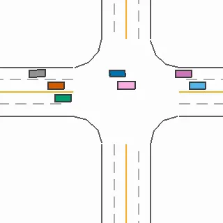

# Driving suite (a car on MetaDrive roads)

The driving suite has 7 tasks in `tasks/driving/`: a passenger car on procedurally built roads with traffic, road works and junctions. It is the wheeled embodiment of Robo Use: the agent is the driver and makes the tactical decisions (speed for a bend, when to change lanes, when to give way and wait for a gap), while skills do the low-level lane keeping.

- Backend: `src/robouse/backends/driving.py` (embodiment declaration, skills, judge, task scenes, reference solutions).
- Simulator worker: `src/robouse/backends/driving_worker.py` (runs in MetaDrive's own virtualenv; scene manager, event monitor, observation, controllers under the skills, rendering).
- Generator: `python adapters/driving/generate.py` (needs the MetaDrive virtualenv: it starts each scene once to write the route facts into the instruction).



## Simulator and licences

[MetaDrive](https://github.com/metadriverse/metadrive) 0.4.3 (code: Apache-2.0; Li et al., "MetaDrive: Composing Diverse Driving Scenarios for Generalizable Reinforcement Learning", TPAMI 2022). Roads are built from MetaDrive's procedural blocks (straight, curve, roundabout, intersection, on-ramp) from a fixed block string and seed per task. The ego car and all traffic are Bullet raycast vehicles (engine force, brakes, tyre friction, suspension). Traffic is MetaDrive's IDM car-following policy. No robot model or Menagerie asset is involved (`assets: []`).

On first import MetaDrive downloads its asset pack (168 MB, `metadrive/assets/`, from the MetaDrive 0.4.3 GitHub release). The 3D models in it are third-party Sketchfab models under CC-BY-4.0 (attribution required; each model folder has a `license.txt` naming the author, e.g. `models/barrier`, `models/beetle`, `models/pedestrian`). The suite renders only the 2D top-down view, so those models are downloaded but not shown.

## Setup

MetaDrive brings numpy 2, opencv, pygame, panda3d and gymnasium 1.x, which must not enter the Robo Use environment, so it runs in its own virtualenv as a subprocess of the episode server that speaks JSON lines (the DexJoCo pattern).

```
uv venv -p 3.11 ~/.cache/robouse/metadrive-venv
uv pip install -p ~/.cache/robouse/metadrive-venv/bin/python metadrive-simulator==0.4.3
```

- The backend looks for `~/.cache/robouse/metadrive-venv/bin/python`; override with `ROBOUSE_METADRIVE_PYTHON`. Set `ROBOUSE_METADRIVE_QUIET=0` to see the worker's stderr.
- The worker runs with its own folder as working directory (a stray `profile.py` in the caller's directory cannot shadow the standard library) and with `SDL_AUDIODRIVER=dummy`, `SDL_VIDEODRIVER=dummy` (pygame's audio initialisation otherwise costs about 15 s per start on macOS).
- The very first import after installation downloads the asset pack and builds caches; after that, starting the worker and building a scene takes about 2.5 s.
- Only the top-down renderer (pygame) is used. MetaDrive's 3D cameras (panda3d) cannot open an offscreen window headless on macOS ("Could not open window"), so there is no forward camera.
- If the worker dies, every later request returns "simulator worker died (...)"; `success()`/`judge()` return False instead of raising, so `robo done` still ends and scores the episode (0).

## Action and controllers

One step is one MetaDrive step: 0.1 s (5 Bullet substeps of 0.02 s).

| Action group | Components | Values |
|---|---|---|
| `vehicle.controls` (mode `vehicle_controls`) | [STEER, THROTTLE] | each in [-1, 1]: STEER x 40 deg front-wheel angle (+ = left); THROTTLE > 0 engine force, < 0 brake force, 0 coasts |

This is MetaDrive's own car action, with no controller underneath. Zero throttle coasts, so the group declares `hold = [0, -1]`: during the 10-step settle after `robo done` the wheels are straightened and the brakes are fully on. Full braking stops the car from 50 km/h in about 11 m. MetaDrive's default car gets no engine force above 80 km/h. A braked car at standstill jitters by up to about 1 km/h in Bullet, hence the 2 km/h "at rest" threshold.

## Skills

The skills are closed-loop generators on the Robo Use side that ask the worker for one action per step and yield it:

- `follow_route SPEED_KMH METERS`: keeps the current lane along the navigation route for METERS at a set speed. Steering is a Stanley controller at the front axle (heading error + cross-track term + road-curvature feed-forward) on the lane centre line of the route; speed is PI cruise control. It does not brake for vehicles or obstacles and does not slow for curves. If the lane ends before its road does (the on-ramp's acceleration lane) it holds the lane's last heading and runs off the end, as a lane-keeping controller would. It reports distance driven, speed, lane, remaining distance and the nearest vehicle or object ahead in the lane, and stops early if an event happens.
- `change_lane left|right [SPEED_KMH]`: the same Stanley controller aimed at the adjacent lane until centred (lateral error below 0.3 m, heading error below 3 deg). It does not check traffic or line types.
- `stop [METERS]`: brakes to a standstill while lane keeping, with a constant deceleration over about METERS (0 = full brake). Reports the stopping distance and whether the car is in the destination zone.
- `wait SECONDS`: brakes held.

The controllers read only the public observation plus the lane centre lines of the route (like a navigation map); they never see traffic intentions.

## Observation and cameras

`robo observe` reports `ego` (position, heading, speed, last action), `lane` (road, lane index from the left, lane count, lateral offset, station, road shape, left/right line types), `route` (travelled, remaining, route completion, next three roads with distance, lane count and shape such as "curve right, radius 17 m, turning 60 deg", destination, `in_destination_zone`, and `give_way` where that rule applies), `vehicles` and `obstacles` within 60 m (position in the car's frame, distance, speed, relative heading, road and lane, and for objects on the route the distance along it, bumper gap and `in_my_lane`; `broken_down` for a stopped car), and `events`. Cameras: `topdown` (follows the car, map +y up, 5 px per metre, 96 m across at 480 px) and `route_map` (the whole route).

## Tasks

Every task has the same success rule, judged on the trusted side from the worker's state: after `robo done` and the 10-step settle, the car is at rest (below 2 km/h) inside the destination zone (MetaDrive's `arrive_dest` region: from 5 m before the end of the route's final road to 5 m past it, any lane; `route.remaining_m` between -5 and 5; the final road ends at the map's edge, so driving past `remaining_m` = 0 leaves the road and the task text tells the agent to stop before it), and the monitor recorded no event at any time:

- `crash_vehicle`, `crash_object`, `crash_building`, `crash_human`, `crash_sidewalk` (MetaDrive's contact flags);
- `out_of_road`: off the lanes, or touching a solid white or yellow line (MetaDrive's rule);
- `cut_off`: a vehicle behind in the car's lane (within 30 m, within 1.6 m laterally, heading within 35 deg) closes in faster than 0.3 m/s with a time gap under 1 s. MetaDrive's IDM followers keep 10 m + 1.5 s (5 m + 1 s for the dense scripted streams), so this only happens when the car cuts in or brakes hard in front of them;
- `failed_to_yield` (roundabout only): while the car is on the entry road, another vehicle is within 15 m of the conflict point and approaching it, or less than 4 s from it. The rule (road, point, window) is published as `route.give_way`.

| Task | Map (blocks, seed) | Scene | Decisions | Budget |
|---|---|---|---|---|
| driving-winding-road | `CSCC`, 0; 2 lanes | no traffic; two long right-hand bends (radius 52 to 60 m, 115 and 125 deg), the second followed by a 25 m-radius left bend (S-bend); 572 m | speed per bend, precise stop | 1000 |
| driving-highway-overtake | `SSSSSSSS`, 1; 3 lanes | truck at 30 km/h ahead in the ego lane, slow cars in the middle and right lanes, cars at 70 km/h from behind in the left lane; 571 m | when to change lanes into a gap; following the truck runs out of budget | 500 |
| driving-broken-down-car | `SCS`, 2; 2 lanes | broken-down car blocks the right lane with a warning triangle 12 m behind it; three cars pass in the left lane at about 50 km/h | wait behind the triangle or change lanes into a gap | 800 |
| driving-cone-zone | `SCS`, 4; 3 lanes | cone taper, barrier and a 45 m cone row close the two right lanes on a right-hand curve; slower car (35 km/h) in the open lane | change lanes twice before the taper, keep distance | 900 |
| driving-roundabout | `SOS`, 0; 2 lanes | a dense queue of cars (5 already circulating, 10 more entering from the north arm every 2.1 s, 30 km/h cruise) passes the entry in the outer lane and leaves by the south exit; route takes the third exit | stop at the entry, give way until the queue has passed | 1200 |
| driving-intersection-left-turn | `SXS`, 0; 2 lanes | unsignalised four-way junction; 24 oncoming cars at 40 km/h in both lanes, one every 1 s from t = 3 s (dense IDM, from the east end of the map), two more at 48 and 51 s | stop at the line, wait for the gap after the stream, turn | 900 |
| driving-ramp-merge | `SrS`, 0; ramp + 3 lanes | short on-ramp and a 38 m acceleration lane; a platoon of 14 vehicles at 50 km/h, 20 m apart, in the right lane (9 on the road at the start, 5 entering at the map's start), a faster car in the middle lane | wait at the end of the ramp, merge behind the platoon before the lane ends | 800 |

Scripted scene elements (static objects, broken-down cars, timetabled IDM vehicles with a fixed cruise speed and no lane changes) are spawned by a small MetaDrive manager in the worker (`SceneManager`). A timetabled car waits until its spawn point is clear (no vehicle within 9 m), and scripted cars leave the scene when they drive off the end of the map, as in MetaDrive's own traffic manager. Each scene is fixed; the episode seed (`--seed`) is ignored.

## Validation

Real runner, 2026-09-28, MetaDrive 0.4.3 on the Mac's CPU:

| Harness | Result | Runs |
|---|---|---|
| oracle | 7/7 | `runs/emb-oracle-driving-v2/` |
| noop | 0/7 | `runs/emb-noop-driving-v2/` |

The reference solutions (`solution()` in `driving.py`) drive through the socket with the skills and the public observation only: speed limited by the bend radius (lateral acceleration 2.2 m/s²) and by the vehicle ahead (2 s gap), lane changes only when the target lane has no vehicle alongside, room ahead and a 3 s gap to faster vehicles behind, stopping at the stop line and waiting until no vehicle closes in within 5 s (intersection) or reaches the give-way point within the window plus 3.5 s (roundabout), and waiting at the end of the ramp until the right lane is clear from 80 m back. Oracle episodes take 11 to 20 s of wall time (3 in parallel on the loaded Mac; the roundabout oracle waits about 45 s of simulated time at the entry).

Constant-speed baseline (no decisions): `follow_route` at one speed until 30 m before the end of the route, then `stop` for the rest, run through the backend for every speed from 20 to 60 km/h in steps of 5. Every traffic task fails at every speed:

| Task | 20 | 25 | 30 | 35 | 40 | 45 | 50 | 55 | 60 |
|---|---|---|---|---|---|---|---|---|---|
| highway-overtake | budget | budget | budget | crash | crash | crash | crash | crash | crash |
| broken-down-car | crash | crash | crash | crash | crash | crash | crash | crash | crash |
| cone-zone | crash | crash | crash | crash | crash | crash | crash | crash | crash |
| roundabout | yield | yield | yield | yield, crash | yield | yield | yield | yield, road | yield, road |
| intersection-left-turn | crash | crash | crash | crash | crash | crash | road | road | crash |
| ramp-merge | road, crash | road | road | road | road, crash | road | road | road | road, crash |
| winding-road (no traffic) | budget | pass | pass | pass | pass | pass | pass | pass | road |

(budget = the budget ran out before the destination; crash = collision event; yield = `failed_to_yield`; road = `out_of_road` or `crash_sidewalk`.) The winding road is the lane-keeping task: any moderate constant speed works there, 60 km/h runs over the edge at the S-bend. Scripted wrong attempts also score 0: stopping 15 m short of the destination, rolling past its end (out of road), staying behind the truck (budget exhausted), and changing lanes only 8 m before the cone taper (hits a cone).

Determinism: MetaDrive is deterministic given the map seed and the action sequence. Two processes with the same actions gave identical positions of every vehicle (checked in both of MetaDrive's traffic modes, trigger and respawn), repeated runner episodes produced byte-identical traces, and the v2 validation reproduced the development step counts exactly. Rendering does not change the simulation.

The backend's `judge_detail()` (kept in `last_judge` after scoring) gives the reason for a verdict: `in_destination_zone`, `speed_kmh`, `at_rest` and the event list; the same facts are in every `robo observe` (`route.in_destination_zone`, `ego.speed_kmh`, `events`) and therefore in the trace.

## Model probe

One trial per task with Claude Code against Kimi K3 on Baseten (`claude-code-glm --model moonshotai/Kimi-K3`), 2026-09-28, on the final tasks. Codex with GPT-6 Astra was not probed: every account in the maintainers' Codex pool had hit its usage limit (until 2026-10-03). Runs: `runs/emb-probe-driving-kimi-r2/`.

| Task | Kimi K3 |
|---|---|
| driving-broken-down-car | 1 |
| driving-intersection-left-turn | 1 |
| driving-ramp-merge | 0: merged cleanly, then overran the end of the final road (out of road) |

The ramp-merge failure showed that the task text promised a zone up to 5 m past the road end that the map cannot provide; the text now says the road ends at `remaining_m` = 0. An earlier probe on the pre-review traffic (`runs/emb-probe-driving-kimi/`) scored 2/3.

## Limitations

- Traffic is MetaDrive's IDM: it brakes for what is ahead in its lane but does not yield at junctions or roundabouts and does not react to a car cutting in beside it. PG maps have no traffic lights, so there are no red-light violations to check; the give-way rule is checked only in the roundabout task (in the intersection task a failure to yield ends in a collision with the dense stream).
- Scripted traffic enters at fixed times at the map's edges (e.g. the east arm of the intersection is only 35 m long), so cars can enter the 60 m observation radius already moving.
- State is exact (no sensor noise, perfect detection within 60 m, no occlusion); there is no forward 3D camera on this Mac (headless panda3d fails).
- The world is paused between agent commands, so reaction time is not tested; only the decisions and their timing in simulated time are.
