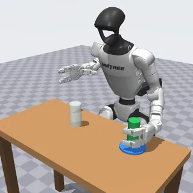

# Humanoid suite (four humanoids on a stand, table-top manipulation)

The humanoid suite has 9 tasks in `tasks/humanoid/`: upper-body manipulation with four MuJoCo Menagerie humanoids, each fixed to a support stand in front of a table.

- Backend: `src/robouse/backends/humanoid.py` (declaration, controller loop, skills, monitor, judge); helpers in `src/robouse/backends/humanoid_sim/` (`robots.py` robot configurations, `scene.py` scene builder, `control.py` servo and IK, `tasks.py` scenes and success rules, `oracles.py` reference solutions).
- Generator: `python adapters/humanoid/generate.py`.

## Robots and licences

All from MuJoCo Menagerie at the pinned commit `8161bba2...` (`robouse fetch-assets`; hashes in `assets/menagerie/embodiments.json`).

| Robot | Menagerie folder | Licence | Arms | End effector |
|---|---|---|---|---|
| Unitree G1 | `unitree_g1` (`g1_with_hands.xml`) | BSD-3-Clause | 7 DoF, position actuators | Dex3-1 hand: thumb (3 joints) and two fingers (2 joints each), upstream torque limits 1.4-2.45 N m |
| Unitree H1 | `unitree_h1` | BSD-3-Clause | 4 DoF, torque motors | none: the forearm ends in a 6.6 cm ball |
| Apptronik Apollo | `apptronik_apollo` | Apache-2.0 | 7 DoF, position actuators | rigid plate (the modelled fingers have no joints) |
| Booster T1 | `booster_t1` | Apache-2.0 | 4 DoF, position actuators | rigid 6 cm round hand |

Changes to the upstream models:

- The root body's free joint is removed: the pelvis (T1: trunk) is fixed to the world and a visual stand is drawn behind it. The robots do not balance or walk. The legs, waist and neck hold a standing pose with their own actuators: the Menagerie keyframe, plus a 26 degree forward waist bend on the G1 and a 14 degree torso pitch on Apollo. The T1 trunk is mounted leaning 20 degrees forward, and its hips compensate so that its legs stay vertical. The root height puts the lowest foot point 3 mm above the floor.
- Collision: the robots' collision geoms (group 3) collide with the world and objects but not with each other. Apollo's collision geoms are disabled upstream and are enabled here. Robot contact friction is 1.0, with low torsional friction.
- Physics step 2 ms for every robot (Apollo upstream: 5 ms), implicitfast integrator, elliptic friction cones, impratio 10.

Every task in this suite has the humanoid on a support stand with its root welded to the world: the robot does not balance, walk or move its base, and every task text says so.

## Scene

World frame: +x forward from the robot, +y to its left, +z up, origin on the floor below the pelvis. Each robot stands in front of a table sized to its reach: G1 0.72 m, H1 0.92 m (a counter), Apollo 0.88 m, T1 0.56 m. Tasks add plates, coasters, a drawer cabinet (slide joint, 16 cm travel, damping and friction), a button panel (spring-loaded slide joints), shelves, a bin, a mat, zones and free objects. All positions and sizes are public under `scene` and `objects` in `robo observe`.

## Action and controller

One step is 40 ms (20 physics steps). `robo act` takes the concatenation of the task's action groups, each value in [-1, 1]:

| Group | Components | Meaning | Robots |
|---|---|---|---|
| `left.ee_delta`, `right.ee_delta` (`ee_delta_pos`, world frame) | LDX LDY LDZ, RDX RDY RDZ | move that hand's goal point by up to 2 cm per step | all |
| `left.gripper`, `right.gripper` (`gripper`) | LGRIP, RGRIP | +1 closes / -1 opens the Dex3 finger synergy by 0.2 per step, 0 keeps it | G1 |
| `head.delta` (`joint_delta`) | HYAW, HPITCH | neck yaw (+ left) and pitch (+ down), 3 degrees per step | Apollo, T1 |

Zero on every group holds the robot still.

The controller under the action works as follows:

1. Goal handling. Each hand has a goal point, and `ee_delta` moves it. The goal is kept within 6 cm of the measured hand and within 1.5 cm of what the arm can reach, so a blocked or overreaching arm stops instead of winding up.
2. Inverse kinematics. Every control step, a warm-started damped least-squares IK (damping 3e-3) turns the goal into arm joint setpoints, moving each joint at most 0.12 rad per step. On the 7-DoF arms it also holds a fixed hand orientation (weight 0.35 per rad): on the G1, fingers forward and level with the palm facing the midline; on Apollo, pointing forward with the palms facing each other. A posture term acts in the null space. If the warm start is stuck, the IK is re-solved from the start posture.
3. Integral term. A bounded term (0.25 per step, at most 3 cm) removes the steady sag of a loaded arm.
4. Joint servos. On the G1, Apollo and T1, the upstream position actuators track the setpoints, plus a gravity feed-forward term; the joints' upstream torque limits apply. On the H1, a joint PD with gravity compensation drives the torque motors every 2 ms, clipped to their ranges: shoulders kp 300 / kd 8, elbows kp 200 / kd 5, hips, knees and torso kp 300 / kd 15, ankles kp 60 / kd 4.
5. Fingers (G1). A single synergy runs from open to closed: thumb swings in, fingers curl. The upstream finger torque limits make the fingers stop on contact. Grasps are friction grasps; nothing is welded.

## Skills

- `reach SIDE X Y Z [TOL]`: moves the goal in a straight line at 2 cm per step. It reports `reached`, `blocked` (the hand stalled, for example on contact) or `out_of_reach`, with the hand position and what the hand touches.
- `reach_both XL YL ZL XR YR ZR [TOL]`: the same for both hands at once (bimanual holds).
- `home`: both hands back to their start points.
- `wait [STEPS]`: hold still.
- `grasp SIDE` / `release SIDE` (G1 only): close the fingers until they stop, or open them. `grasp` reports what the hand touches and whether an object is held between the thumb and the fingers.
- `look_at X Y Z` (Apollo, T1): turns the neck so the head camera points at the point, closed loop on the measured neck angles. It reports the final angle off target, since the neck has joint limits.

Skills do not avoid obstacles, and they can end blocked or out of reach. Choosing the approach direction, the height, the hand and the order is the agent's job.

## Observation and cameras

`robo observe` reports:

- `robot.hands.left` / `right`: `pos` (control point), `goal`, and `touching` (objects in contact with the hand, or the forearm on the H1, Apollo and T1). The G1 also reports `grip` and `holding`.
- `robot.head` (Apollo, T1) and `robot.mount`.
- `objects`: centre `pos`, `tilt_deg`, `touched_by_robot` and size.
- `scene`, `progress` and `safety_events`.

Cameras: `front` (default), `top`, `side` and `head`. The head camera is on the head for Apollo and the T1, and on the upper torso, at head height, for the G1 and H1.

## Tasks

| Task | Robot | Goal | Success (final state plus monitor; no safety event) | Budget |
|---|---|---|---|---|
| g1-can-to-plate | G1 | stand the red can on the plate | can upright (<= 15 deg), centre within 7 cm of the plate centre, resting on the plate, not touched by the robot | 500 |
| g1-pass-across | G1 | move a bottle from the far right to a coaster at the far left; neither hand reaches both; a fragile glass stands right of the middle | bottle upright (<= 15 deg), centre within 6 cm of the coaster centre, resting on it (centre within 5 mm of resting height), not touched; touching or tipping the glass is a safety event | 900 |
| g1-drawer-stow | G1 | open the drawer by its bar handle, put the soap in, close the drawer | soap centre inside the drawer tray, drawer open <= 1.5 cm, soap not touched | 1200 |
| h1-box-to-shelf | H1 | squeeze-lift a 0.5 kg box between the fists onto a 10 cm shelf block | box flat (<= 8 deg), centre over the shelf top, resting on it, not touched | 700 |
| h1-panel-sequence | H1 | press yellow, green, white, blue on a vertical panel; never red | recorded presses (8 mm travel) are exactly that sequence; pressing red is a safety event | 600 |
| apollo-box-into-bin | Apollo | squeeze-lift a 0.6 kg box between the palms into a bin with 7 cm walls | box centre inside the bin's inner footprint, resting on the bin floor (<= 2 cm above resting height), not touched | 700 |
| apollo-carry-tray | Apollo | carry a tray with a loose cup onto a mat | tray entirely on the mat, flat (<= 5 deg), resting; cup upright (<= 10 deg); neither touched; the cup touching anything but the tray (including the robot) is a safety event | 700 |
| t1-push-cans | T1 | push a red and a blue can into their zones | each can's centre within 4 cm of its zone centre, both standing (<= 15 deg) | 700 |
| t1-box-onto-step | T1 | squeeze-lift a 0.3 kg box onto a 6 cm step | box flat (<= 8 deg), centre over the step, resting on it, not touched | 600 |

Any object touching the floor is a safety event in every task that has free objects. Success is judged after `robo done` and a 10-step hold.

## Validation

Real runner, 2026-09-28, MuJoCo 3.3.0, concurrency 3, on a loaded Mac:

| Harness | Result | Runs |
|---|---|---|
| oracle | 9/9 | `runs/emb-oracle-humanoid-v2/` |
| noop | 0/9 | `runs/emb-noop-humanoid-v2/` |

The oracle episodes use 78-275 steps and take 7-25 s of wall time each when the machine is not saturated. Every noop trial ran to `robo done` (none was an infrastructure failure). Episode setup compiles the scene in about 1 s (T1) to 10 s (Apollo). The reference solutions use only the skills and public observation fields.

Scripted wrong attempts score 0:

- the can set down beside the plate;
- the soap put in the drawer with the drawer left open;
- the buttons pressed in the wrong order, and with red pressed (safety event);
- the box shoved sideways instead of lifted;
- the tray set down 10 cm short of the mat.

The videos were checked frame by frame: no interpenetration, no teleporting, and objects move only through contact.

## Model probe

One trial per task with Claude Code against Kimi K3 on Baseten (`claude-code-glm --model moonshotai/Kimi-K3`), 2026-09-28. Codex with GPT-6 Astra was not probed: every account in the maintainers' Codex pool had hit its usage limit (until 2026-10-03). These are probes, not rates. Runs: `runs/emb-probe-humanoid-kimi/, runs/emb-probe-humanoid-kimi-r2/`.

| Task | Kimi K3 |
|---|---|
| h1-panel-sequence | 1 |
| g1-drawer-stow | 1 |
| apollo-carry-tray | 1 |

g1-drawer-stow and apollo-carry-tray were rerun on the fixed tasks (`-r2`): the first attempts ran out of wall time during a machine-wide stall of about 17 minutes with no requests (visible as one gap in both traces).

## Limitations

- The robots are fixed to a stand. There is no balance, no walking and no whole-body motion; the legs only hold a pose.
- Future work: walking. A physical gait needs a learned whole-body policy; training one (for example the MuJoCo Playground humanoid joystick policies for the G1 or T1) needs a GPU. With such a policy, `walk_to` and `turn` skills could sit on top of a `base.twist` action group.
- The 7-DoF arms hold one fixed hand orientation per task, and the agent cannot rotate the wrist. The G1's hand is long (fingertips 8 cm beyond the grasp point), so objects are approached from behind or above. Objects placed in the drawer are released above the drawer front and drop in.
- The 4-DoF arms (H1, T1) have no wrist, so a box squeezed between the hands rolls with the forearms while it is carried. In the reference runs the box tilts by about 20 to 30 degrees in transit and settles flat when it is set down.
- Apollo's forearms are wider than its hand plates, so they share the squeeze.
- Each hand reaches only a little past the robot's midline. The layouts were tuned to each robot's reachable workspace.
- Each task has one fixed layout, with no randomisation. State is exact, with no sensor noise.
- The T1 head camera is aimed at its table, and the neck cannot lift it to eye level (`look_at` reports the remaining angle).
