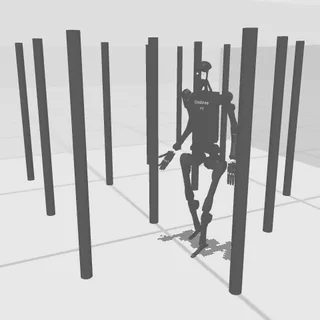

# HumanoidBench suite

7 whole-body tasks in `tasks/humanoidbench/`, adapted from [HumanoidBench](https://sferrazza.cc/humanoidbench_site/) (Sferrazza, Huang, Lin, Lee, Abbeel, "HumanoidBench: Simulated Humanoid Benchmark for Whole-Body Locomotion and Manipulation", RSS 2024, [arXiv 2403.10506](https://arxiv.org/abs/2403.10506)). The robot is HumanoidBench's `h1hand`: a free-standing Unitree H1 humanoid with a Shadow dexterous hand on each arm, in MuJoCo, on the CPU. Each task is HumanoidBench's own `h1hand-<task>-v0` environment, unchanged, judged by HumanoidBench's own reward and success rule: stand, walk, maze, pole forest, sit on a chair, reach a point with the left hand, push a box on a table.

- Backend: `src/robouse/backends/humanoidbench.py` (task table, embodiment declaration, skills, verdict, reference-solution entry point).
- Simulator worker: `src/robouse/backends/humanoidbench_worker.py` (runs in HumanoidBench's own virtualenv: the environments, the walking controller, the arm inverse kinematics, the success rule, observation, rendering).
- Reference solutions: `src/robouse/backends/humanoidbench_oracles.py` (socket only, numpy only).
- Generator: `python adapters/humanoidbench/generate.py` (needs the HumanoidBench virtualenv; it starts each task once to read its success bar and camera).



## Source and licences

- HumanoidBench code, task scenes and robot assets: [carlosferrazza/humanoid-bench](https://github.com/carlosferrazza/humanoid-bench) (the GitHub user of Carmelo Sferrazza, first author; UC Berkeley Robot Learning Lab), pinned commit `cb1189039151c8aadaaa987b442da54383c87fab` (2025-09-18, the latest). [LICENSE](https://github.com/carlosferrazza/humanoid-bench/blob/main/LICENSE): MIT, "Copyright (c) 2024 Robot Learning Lab (RLL) lab @ UC Berkeley"; the same file carries the MIT notices of the bundled training code (jaxrl_m, DreamerV3, TD-MPC2), which Robo Use does not use.
- Robot assets inside that repository, each with its own LICENSE file: Unitree H1 and G1 (`humanoid_bench/assets/h1`, `g1`): BSD-3-Clause, Copyright Unitree Robotics; Shadow Hand (`shadow_hand_menagerie`, `shadow_hand_submodel`): Apache-2.0; Robotiq 2F-85: BSD-3-Clause (ROS-Industrial); kitchen models (adept_models, franka): Apache-2.0.
- Walking controller: Unitree's pretrained H1 locomotion policy `deploy/pre_train/h1/motion.pt` from [unitreerobotics/unitree_rl_gym](https://github.com/unitreerobotics/unitree_rl_gym), pinned commit `276801e46c5d433564f24658bac64f254b7d2d4b`, BSD-3-Clause ([LICENSE](https://github.com/unitreerobotics/unitree_rl_gym/blob/main/LICENSE), Copyright Unitree Robotics). SHA-256 `44a0fbce...589eb`; the pinned download manifest is `assets/humanoidbench/provenance.json`.

All of these allow redistribution and use in a public benchmark (keep the notices). Dataset: `carlosferrazza/humanoid-bench` (the benchmark's GitHub owner, verified with `gh api repos/carlosferrazza/humanoid-bench`: a user account, not an organisation).

## Feasibility: why a walking controller, and which tasks

HumanoidBench's raw action is 61 joint position targets (19 body joints and 42 hand joints) for a robot that must balance by itself. Without a trained policy nothing works:

- Holding the start pose (the keyframe's joint angles as position targets) the robot falls within 1.3 to 2.5 s on every seed tried (h1-stand 65 to 96 steps, h1hand-stand 84 to 125 steps; HumanoidBench's episodes are 1000 steps).
- HumanoidBench ships only two pretrained low-level policies, `data/reach_one_hand` and `data/reach_two_hands` (MLPs for hierarchical reaching). They keep the robot up, but in a test on h1hand-push the hands missed their targets by 2 to 28 cm and the pelvis wandered 0.3 to 0.5 m, which is not precise enough to build manipulation tasks on. They are not used.
- Unitree's own pretrained H1 walking policy (unitree_rl_gym, trained in Isaac Gym, with a MuJoCo sim-to-sim deploy script) transfers to HumanoidBench's H1 unchanged (same 50 Hz control, similar joint gains): with the walking policy driving the legs, `h1hand-walk` reached a return of 882 to 892 (success bar 700) and `h1hand-stand` 978 (bar 800) on three seeds each, with no fall. It is a velocity-command policy (forward, sideways, turn rate) that steps in place at zero command. This is the layer under `robo act`.

Tasks were then chosen where success is physical and a scripted reference solution through the socket is reliable:

| HumanoidBench task | Included | Evidence |
|---|---|---|
| stand, walk | yes | walking policy alone passes the bar |
| maze | yes | walking to the three checkpoints passes the bar (1200) at step 787 |
| pole | yes | a diagonal lane through the staggered pole grid, no pole touched, bar 700 at step 720 |
| sit_simple | yes | a scripted sit-down motion (skill `sit_down`) lands on the seat on 8/8 seeds, bar 750 at step 783 to 849 |
| reach | yes | walk next to the target, then arm IK holds the left hand within 5 cm despite the stepping sway; bar 12000 at step 703 (also solved on seeds 7, 9, 10, 11) |
| push | yes (seed 12) | clamping the box between both hands and sliding it; solved on seeds 7 and 12 (seed 5 only with an earlier version of `walk_to`) |
| run | no | needs 5 m/s; the walking policy walks at about 0.9 m/s |
| stair, slide, hurdle | no | the walking policy is trained on flat ground: it fell within 2 s on stairs, fell or scored 299 on the slide, scored about 120 on the hurdle course (bar 700 to 750) |
| crawl, balance_simple, balance_hard, highbar | no | need postures or balancing (crouched crawl, standing on a board on a rolling cylinder, hanging) that the walking policy cannot produce |
| package | no | the 0.7 m tall, 0.28 kg package stands on the floor: the hands do not reach below about 0.85 m, and pushing it with the legs tips it (it tips when pushed above 0.2 m of height with the default friction), and a tipped package fails the 10 cm check |
| door | no | the door swings toward the robot against a 50 N m/rad spring and opens only by pulling its handle, which needs a grasp |
| cube, bookshelf, spoon, window, kitchen, cabinet, truck, insert, powerlift, basketball, room | no | need grasping or in-hand manipulation with the Shadow hands (or throwing, lifting a heavy barbell, tidying six objects across the room); the controller here holds the fingers still, and no scripted grasp controller for the Shadow hands was attempted |
| push, other seeds | no | from the closest stances to the table (pelvis at x = 0.2 to 0.28 m, the edge at 0.4 m) a hand reaches about 0.66 to 0.7 m at box height, so goals beyond x of about 0.78 m are out of reach; the clamp solution failed on seeds 0, 1, 2, 3, 4, 6, 8, 10, 11 (goals at x >= 0.82 m, or 0.48 m to the side) |

## Setup

HumanoidBench pins mujoco 3.1.6, gymnasium 0.29.1 and dm_control 1.0.20, which conflict with the main Robo Use environment (mujoco 3.3.0, gymnasium 1.3.0), so it runs in its own virtualenv as a subprocess of the episode server that speaks JSON lines (the DexJoCo, driving and dm_control pattern).

```
git clone https://github.com/carlosferrazza/humanoid-bench ~/.cache/robouse/src/humanoid-bench      # 407 MB
git -C ~/.cache/robouse/src/humanoid-bench checkout cb1189039151c8aadaaa987b442da54383c87fab
uv venv -p 3.11 ~/.cache/robouse/humanoidbench-venv
VIRTUAL_ENV=~/.cache/robouse/humanoidbench-venv uv pip install -r requirements-humanoidbench.txt    # robohub templates/runtimes/humanoidbench/
VIRTUAL_ENV=~/.cache/robouse/humanoidbench-venv uv pip install --no-deps -e ~/.cache/robouse/src/humanoid-bench
mkdir -p ~/.cache/robouse/humanoidbench
curl -L -o ~/.cache/robouse/humanoidbench/h1_motion.pt \
  https://raw.githubusercontent.com/unitreerobotics/unitree_rl_gym/276801e46c5d433564f24658bac64f254b7d2d4b/deploy/pre_train/h1/motion.pt
```

- `requirements-humanoidbench.txt` is HumanoidBench's own pins plus their dependencies (31 packages). `--no-deps` skips HumanoidBench's `setup.py` list, which also pins torch, jax-based brax, gymnax and mujoco-mjx for its training code; none are needed. HumanoidBench imports `jax.numpy` and `torch` at module level only for its hierarchical-policy wrappers, so the worker puts stand-in modules in their place when they are missing, and it reads the TorchScript walking policy with a small zip/pickle reader and runs it in numpy (an LSTM with 64 units and a 64-32-10 actor).
- The backend looks for `~/.cache/robouse/humanoidbench-venv/bin/python` (override with `ROBOUSE_HUMANOIDBENCH_PYTHON`) and the policy at `~/.cache/robouse/humanoidbench/h1_motion.pt` (override with `ROBOUSE_HUMANOIDBENCH_POLICY`). Set `ROBOUSE_HUMANOIDBENCH_QUIET=0` to see the worker's stderr.
- The worker forces single-threaded BLAS (`OPENBLAS_NUM_THREADS=1`): the arm IK solves small systems every step, and with threaded BLAS on macOS a control step took 300 ms instead of 5 ms.
- Speed: a 1000-step episode runs in 2 to 5 s of simulation on an M2 Max; through the runner, with video, a reference-solution episode takes 13 to 23 s.

## The controller under `robo act`

One control step is 20 ms (HumanoidBench's own 50 Hz: 10 MuJoCo steps of 2 ms); HumanoidBench's reward, termination and success are computed on every step exactly as in its environment.

- **Legs**: the Unitree walking policy, fed the same 41 observations as unitree_rl_gym's `deploy_mujoco.py` (body angular velocity, gravity direction, the scaled velocity command, leg joint angles and velocities, its previous action, a 0.8 s gait phase), outputs the 10 leg joint targets. At reset the legs are set to the policy's standing stance (HumanoidBench's keyframes start with bent knees) and the arms to a neutral pose (upper arm down, forearm forward; HumanoidBench's push keyframe raises the right arm backwards, from where the IK cannot bring the hand forward). Everything else, including HumanoidBench's start-state noise, is HumanoidBench's reset.
- **Zero command holds the spot**: the policy steps in place and drifts a few centimetres per second, and it treats planar commands below 0.2 m/s as "stand" (as in its training), so while FORWARD, LEFT and TURN are all zero the controller walks back at 0.25 to 0.35 m/s whenever the pelvis is more than 4 cm from where the robot stopped, and turns back to that heading.
- **Arms**: each hand has a goal point in the robot's heading frame (x forward, y left, origin on the floor under the pelvis, z height). Every step, damped least-squares IK on the 4 arm joints (a null-space pull toward the neutral arm, a restart from the neutral arm when stuck) turns the goal into joint targets (rate-limited), plus gravity feed-forward (`qfrc_bias / kp`) and a slow bounded integral term so the position servos hold the hand where IK put it. The goal never runs more than 10 cm ahead of the hand. Wrists, fingers and the torso joint hold their start positions.
- **Sit-down** (skill `sit_down`, one-way): the policy stops, both legs go to its stance (2 steps), then hips and knees bend to about 90 degrees (hip pitch -1.3, knee 1.6, ankle 0.15 rad) in 30 steps; the pelvis drops about 0.3 m and moves about 0.2 m back.

## Action, skills, observation, scoring

- **Action** (9 numbers): `FORWARD LEFT TURN` (base.velocity: m/s in [-1, 1], m/s in [-0.5, 0.5], rad/s in [-1, 1], heading frame), `LDX LDY LDZ` and `RDX RDY RDZ` (hand goal deltas, x 2 cm per step, heading frame). Hold value (settle): zeros, which holds the spot and the hand goals.
- **Skills**: `walk_to X Y [HEADING_DEG] [TOL]` (turn toward the point, walk, slow down, turn to the heading; stops when there, when blocked or on a fall; no obstacle avoidance), `walk FORWARD LEFT TURN STEPS`, `turn_to HEADING_DEG`, `stand STEPS`, `reach left|right X Y Z [TOL]` (straight-line hand motion to a world point, re-planned every step against the sway; afterwards the hand keeps tracking that world point until the next command for that hand), `hands_home`, `sit_down`.
- **Observation**: `robot` (pelvis position, heading, head height, torso uprightness, centre-of-mass velocity in world and heading frame, the current command, the held spot, per hand the world position, heading-frame position and goal and the world point it holds, `fallen`, `seated_mode`), `scene` (per task: maze checkpoints, next checkpoint and wall blocks; pole positions; chair; reach target and hand distance; table, box, goal and box-to-goal distance) and `progress` (HumanoidBench's return so far, last reward and its terms, steps, the success bar, `solved`). Cameras: HumanoidBench's view for the task (`cam_default`, `cam_maze` or `cam_tabletop`, all following the robot); the push goal and reach target, which HumanoidBench draws only in its interactive viewer, are drawn as red markers.
- **Success** (`success_mode: first`, the episode ends as solved the moment it holds; `robo done` before that, give-up or the end of the budget scores 0): HumanoidBench's success rule for the task. For stand, walk, maze, pole, sit_simple and reach it is the published success threshold on the episode return (`success_bar`: 800, 700, 1200, 700, 750, 12000) within HumanoidBench's episode length (1000 steps); for push it is HumanoidBench's `success` signal (box centre within 5 cm of the goal) within its 500-step episode. A fall that HumanoidBench terminates (pelvis below 0.2 m, or 0.5 m for pole and sit) freezes the episode, which can then no longer succeed.
- **Seeds**: `robouse.seed` in `task.md` seeds HumanoidBench's reset (start-state noise, and for reach and push the target or goal drawn from numpy's global generator). The reference solutions are validated on the bundled seeds; other seeds give other layouts, and some push goals are out of reach (see above).

## Tasks

| Task id | HumanoidBench env | Seed | Success | Budget | Reference solution |
|---|---|---|---|---|---|
| humanoidbench-stand | h1hand-stand-v0 | 0 | return >= 800 | 1000 | `stand` until solved (step 822) |
| humanoidbench-walk | h1hand-walk-v0 | 0 | return >= 700 | 1000 | FORWARD 1 with heading held at 0 (step 758) |
| humanoidbench-maze | h1hand-maze-v0 | 0 | return >= 1200 | 1000 | `walk_to` each checkpoint (step 787) |
| humanoidbench-pole | h1hand-pole-v0 | 0 | return >= 700 | 1000 | hands in at the hips, pure pursuit along diagonal lanes through the gaps (step 720) |
| humanoidbench-sit-simple | h1hand-sit_simple-v0 | 0 | return >= 750 | 1000 | `sit_down` from the start spot (step 787) |
| humanoidbench-reach | h1hand-reach-v0 | 0 (target (0.20, 0.86, 1.28)) | return >= 12000 | 1000 | `walk_to` beside the target, `reach left` (step 703) |
| humanoidbench-push | h1hand-push-v0 | 12 (goal (0.75, 0.24)) | box within 5 cm of goal | 500 | walk to the table, clamp the box between the hands, slide it (step 199) |

## Validation

Local runner (`robouse run-many`, macOS, M2 Max):

- Reference solutions: **7/7** (`runs/humanoidbench-oracle`), solved at steps 199 to 822, 12 to 17 s of wall time per episode.
- No-op control: **0/7** (`runs/humanoidbench-noop`).
- Robustness of the reference solutions, in-process runs on the bundled layout with 6 other seeds for HumanoidBench's start-state noise (the `noise_seed` test hook): 6/6 on every task (42/42). With other layout seeds: stand, walk, pole solved on seeds 0 to 3, maze on seeds 0 to 9, sit_simple on 0 to 7, reach on 0, 7, 9, 10, 11, push on 7 and 12.

Hub runtime in Docker (Colima, linux/arm64; scratch copy of robohub with the `humanoidbench` runtime and dataset, `bench eval run --agent oracle`, bench 0.7.4):

- Image: 2.23 GB on disk (574 MB content): python:3.12-slim, the Python 3.11 venv with HumanoidBench's pins (no torch, no jax), HumanoidBench's package and assets (training code and its pretrained reaching policies removed), the walking policy. The build ends with a smoke test in which the worker builds a scene, loads the policy and steps.
- Reference solutions: **7/7** (`runs/humanoidbench-docker/oracle-2026-09-29__05-07-26`), at the same steps as on the Mac within 1 (maze 786, pole 720, push 199, reach 703, sit 787, stand 823, walk 759), 47 to 222 s per trial.
- No-op control (`carlosferrazza/humanoid-bench-noop-control`, walk and push): **0/2** (`runs/humanoidbench-docker/noop-2026-09-29__05-21-10`).
- The first Docker run failed maze (6/7, `runs/humanoidbench-docker/oracle-first-2026-09-29__04-40-41`): on linux/arm64 the robot fell during `walk_to`'s turn at the maze's second corner, because the skill then also sidestepped at 0.5 m/s while turning 85 degrees. `walk_to` now turns in place before walking and keeps the sideways correction under 0.2 m/s while travelling; the rerun above is with that fix.

Model probe, Claude Code harness with Kimi K3 (`moonshotai/Kimi-K3` on Baseten) on 3 tasks (`runs/humanoidbench-probe-kimi`, list `task-lists/humanoidbench-probe.txt`): **3/3**.

| Task | Result | Steps | Wall time | What happened |
|---|---|---|---|---|
| humanoidbench-maze | solved | 809 | 32 s | `walk_to` (3, 0), (3, 6), (6, 6), then waited for the return to pass 1200 |
| humanoidbench-sit-simple | solved | 787 | 158 s | Looked at the camera image, called `sit_down` from the start spot, then `stand` until solved |
| humanoidbench-push | solved | 404 | 1386 s | Walked to the table edge, put the right hand on the box's -y face, then sidestepped the whole body in +y so the hand slid the box; lifted the hand over the box to push its -x face; box 4.7 cm from the goal at step 404 of 500 |

An earlier probe of push (before two fixes) failed at the budget, and its trajectory found two problems that are now fixed: `walk_to` against the table edge kept trying for 156 steps before reporting "blocked" (now 60 steps), and the instruction did not say how close the robot can stand to the table (it now says its legs meet the table with the pelvis 0.1 m from the edge) or that the straight Shadow fingers can snag the box.

## Known limitations

- The layer under `robo act` is a pretrained walking policy plus IK, so these tasks test planning and closed-loop use of a humanoid's velocity and hand-position interface, not low-level whole-body control. Stand and walk in particular are easy with it; they are kept because they are HumanoidBench tasks with a physical, return-based success rule.
- The walking policy was trained on a slightly different H1 model (Unitree's, with a rigid upper body and lower joint gains); it transfers well on flat ground here but the robot sways about 5 cm sideways while stepping in place, which limits hand precision to a few centimetres.
- The Shadow hands' fingers are held still; no HumanoidBench task that needs a grasp is included.
