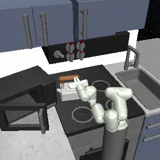

# Franka Kitchen suite

10 tasks adapted from Franka Kitchen as shipped in Farama's [Gymnasium-Robotics](https://robotics.farama.org/envs/franka_kitchen/franka_kitchen/) (`FrankaKitchen-v1`; gymnasium-robotics 1.4.2, gymnasium 1.3.0, MuJoCo 3.3.0). The kitchen comes from Relay Policy Learning (Gupta, Kumar, Lynch, Levine, Hausman, 2019) and is the D4RL / Minari kitchen: a 7-joint Franka Panda with a parallel gripper in front of a microwave, a kettle on a stove, four oven knobs, a light switch, a sliding cabinet and a hinged cabinet. The seven upstream subtasks are each a task of their own, and three tasks ask for four subtasks at once (the D4RL goal sets and one more).

Backend: `src/robouse/backends/kitchen.py` (end-effector interface, observation, success check, reference solutions). Generator: `python adapters/kitchen/generate.py --out tasks/kitchen`. The task list (task id -> subtasks) is `TASKS` in the backend module. It runs in-process in the main environment (no worker virtualenv): `gymnasium-robotics` 1.4.2 must be installed where `robouse serve` runs.

## Source and licence

- Code: [Farama-Foundation/Gymnasium-Robotics](https://github.com/Farama-Foundation/Gymnasium-Robotics), MIT (`LICENSE`, "Copyright (c) 2022 Farama Foundation"). The environment modules (`envs/franka_kitchen/kitchen_env.py`, `franka_env.py`) state that they derive from D4RL and relay-policy-learning and are covered by Apache-2.0.
- Assets: `envs/assets/kitchen_franka/`. The kitchen models carry "Copyright 2020 Google LLC, Licensed under the Apache License, Version 2.0" headers (from [google-research/relay-policy-learning](https://github.com/google-research/relay-policy-learning), Apache-2.0); the Franka model (`franka_assets/chain.xml`) says it is modified from [vikashplus/franka](https://github.com/vikashplus/franka), "licensed under the Apache License".
- No dataset is used: the reference solutions are scripted.
- Hub dataset: `farama-foundation/franka-kitchen` (the GitHub org of Gymnasium-Robotics, which defines `FrankaKitchen-v1` and its task set, consistent with `farama-foundation/gymnasium-robotics`).

## Tasks

| Task id | Subtasks (upstream `tasks_to_complete`) | Step budget | Oracle steps |
|---|---|---|---|
| kitchen-microwave | microwave | 500 | 159 |
| kitchen-kettle | kettle | 500 | 163 |
| kitchen-bottom-burner | bottom burner | 500 | 105 |
| kitchen-top-burner | top burner | 500 | 107 |
| kitchen-light-switch | light switch | 500 | 88 |
| kitchen-slide-cabinet | slide cabinet | 500 | 143 |
| kitchen-hinge-cabinet | hinge cabinet | 500 | 243 |
| kitchen-complete | microwave, kettle, light switch, slide cabinet (D4RL kitchen-complete / Minari `D4RL/kitchen/complete-v2`) | 1500 | 531 |
| kitchen-mixed | microwave, kettle, bottom burner, light switch (the D4RL kitchen-partial/mixed goal) | 1500 | 486 |
| kitchen-burners-cabinets | bottom burner, top burner, slide cabinet, hinge cabinet (all four use knobs or handles away from the stove top) | 1500 | 583 |

The kitchen always starts in the same upstream state (the robot's `init_qpos`, all doors shut, burners and light off, kettle on the front-left burner); the seed only changes the upstream observation noise, which this backend does not expose. So there is one task per goal set, not several seeds. Upstream episodes are 280 steps for four subtasks; the budgets here are larger because an agent works through a CLI in small steps.

## Action: an end-effector interface

The upstream action is 9 joint velocities (7 arm joints and 2 fingers, each in [-1, 1] = +-2 rad/s), which the env turns into a position target `q + v * dt` for the Panda's position servos. That is hard to drive from a shell, so the backend puts an end-effector controller in front of it:

- `robo act DX DY DZ DROLL GRIP`, each in [-1, 1]; one step is the upstream 80 ms (40 physics steps).
- DX DY DZ move a commanded gripper position by up to 3 cm per unit along world x, y, z. The commanded position is kept at most 6 cm ahead of the measured gripper, so pushing into furniture stalls instead of winding up.
- DROLL turns the gripper about its pointing axis by up to 0.1 rad per unit (limited to +-1.6 rad from the start). Positive is clockwise as seen from the robot (the top of the gripper moves toward +x). The gripper otherwise keeps its starting orientation: pointing straight ahead (+y), horizontal, fingers side by side along x.
- GRIP +1 closes the fingers, -1 opens them (a finger position target, sent as the two finger velocities).
- Each step the backend solves one damped-least-squares inverse-kinematics step (6-D: the position error plus the error to the commanded orientation, damping 0.05, a null-space pull toward the starting arm posture, and joints at a limit frozen out of the solve) and passes the resulting joint velocities, clipped to [-1, 1], to the upstream `env.step`. So the physics, servos, limits and timing are upstream's.
- Skills: `robo move-to X Y Z [--grip G]` (straight line at the current roll) and `robo grip G`, the shared session skills; they send 4-number actions, which the backend reads as DROLL = 0.

Why a roll: two subtasks need a wrist turn. An oven knob is turned by gripping its grip bar and turning the wrist (pushing the bar sideways also works for the lower knobs, but the upper ones sit between the light switch and the lower knobs, so the wrist hits them). The kettle handle is a bar along x on top of the kettle, which the fingers can only close on after a quarter turn (fingers above and below the bar). Everything else (microwave and cabinet handles are vertical bars, the light switch is a lever) works at roll 0.

## Observation

| Field | Meaning |
|---|---|
| hand_pos, hand_target | grasp centre between the finger pads (the `end_effector` site; the fingertips reach about 5 cm further along +y), and the commanded position |
| hand_roll, hand_roll_target | measured and commanded roll about +y relative to the start (rad) |
| gripper_open, gripper_width | 0 closed .. 1 open; finger gap in metres |
| arm_joints | the seven arm joint angles (rad) |
| microwave_handle_pos, microwave_hinge_pos | microwave door handle and the door's vertical hinge axis |
| kettle_handle_pos, kettle_pos, kettle_quat, kettle_goal_pos | kettle handle, base position, orientation (w, x, y, z) and the upstream goal position |
| bottom_burner_knob_pos, top_burner_knob_pos | front of the two left knobs' grip bars (the upstream `knob2_site`, `knob4_site`) |
| light_switch_pos | tip of the light switch lever |
| slide_handle_pos | sliding-cabinet handle |
| hinge_handle_pos, hinge_cabinet_hinge_pos | handle of the hinged cabinet's right-hand door and that door's hinge axis |
| subtasks | for each of the 7 subtasks: `joints` (the upstream `achieved_goal` values), `goal`, `distance` (norm of joints - goal), `complete` (distance < 0.3) and `required` |
| goals_complete | how many of this task's subtasks are complete now |

The positions come from the upstream model's sites and bodies; `subtasks` is the upstream `achieved_goal` / `desired_goal` pair for every subtask. The upstream observation adds uniform noise to joint readings; these fields are read noise-free from the simulator state.

## Camera

320x320 renders with `mujoco.Renderer` from the upstream default viewpoint (distance 2.2, azimuth 70, elevation -35, looking at (-0.2, 0.5, 2.0)). Shadows and multisampling are off and the oven hood's spotlight (`ovenlight`, which floods the stove top once shadows are off) is switched off: in the hub's simulator image MuJoCo renders in software (OSMesa), where a kitchen frame with the upstream shadows took about 3.4 s instead of 0.2 to 0.5 s. Lights do not affect the physics.

## Success

Upstream's per-subtask completion check, unchanged: a subtask is complete when the norm of its joint values minus its goal values (`OBS_ELEMENT_INDICES` / `OBS_ELEMENT_GOALS` in `kitchen_env.py`) is below `BONUS_THRESH` = 0.3. A task succeeds when every one of its subtasks is complete, judged on the physical state after `robo done` and a 10-step hold (`success_mode: final`). This is stricter than the upstream episode counter, which removes a subtask once it has been completed even if it is undone later; here a door that swings shut again, or a knob turned past the tolerance, does not count. The instruction states each subtask's joint, goal and resulting range (for example the microwave door must end between -0.45 and -1.05 rad; the upstream goal for "hinge cabinet" is the right-hand door at 1.45 rad with the left door shut).

## Reference solutions

`oracle_main(task_id)` in the backend drives the robot only through the episode socket (`observe`, `act`, `move_to`, `grip`, `done`) and reads only public fields, running one scripted waypoint controller per subtask and backing away from the furniture between subtasks:

- microwave, hinge cabinet: approach the handle from the front, close on it, then carry it around the door's hinge axis (`*_hinge_pos`) in 0.05 rad steps until the door angle is inside the goal range, stopping early if the handle slips out of the hand.
- slide cabinet: close on the handle and pull it along +x until the door is 0.4 m open.
- bottom and top burner: close on the knob's grip bar at roll 0 and turn the wrist (+roll) until the knob angle is just past the goal.
- light switch: with the fingers closed, sweep the lever tip toward -x from its +x side.
- kettle: turn the gripper a quarter turn, close on the handle bar, lift 8 cm, carry the kettle over the goal (correcting for the grasp offset), lower it onto the burner and release.

## Validation

Through the real runner (`robouse run-many`, macOS, the shared dev venv):

| Harness | Run folder | Result |
|---|---|---|
| oracle | `runs/kitchen-oracle` | 10/10 solved (88 to 583 steps; 8 to 15 s of wall time per episode) |
| noop | `runs/kitchen-noop` | 0/10 solved |

In Docker with the hub runtime `base` (scratch hub copy, `bench eval run --agent oracle`, bench 0.7.4, Colima on linux/arm64): oracle 10/10 (4.7 min for the 10 tasks at concurrency 3) and the no-op control (a `solve.sh` that only runs `robo info` and `robo observe`) 0/2 on kitchen-microwave and kitchen-complete. The simulator image is 1.12 GB (the shared `base` runtime; kitchen and adroit add no dependencies).

## Model probe

Claude Code harness with Kimi K3 on Baseten (`claude-code-glm --model moonshotai/Kimi-K3`), `task-lists/kitchen-probe.txt`, run folder `runs/kitchen-probe-kimi`: **4/4**.

| Task | Result | Steps | What happened |
|---|---|---|---|
| kitchen-top-burner | solved | 90 | `move-to` in front of the knob, closed on the grip bar, turned with DROLL +1 until the knob read -0.76 rad, released and backed off |
| kitchen-slide-cabinet | solved | 131 | Closed on the handle and pulled the door along +x |
| kitchen-microwave | solved | 261 | Grasped the handle and pulled it round the hinge in several `move-to` arcs, re-grasping once when the handle slipped |
| kitchen-complete | solved | 838 | All four subtasks in one episode (microwave, kettle carried with a quarter-turned grip, light switch, slide cabinet) |

The single-subtask tasks are within reach of a current model once the interface exposes the handles and hinge axes; the four-subtask task took 838 of 1500 steps. No instruction bugs showed up in the trajectories (the knob and kettle roll conventions were used correctly).

## What was left out and why

- The upstream observation noise (`robot_noise_ratio`, `object_noise_ratio`) is not exposed: the fields are read from the simulator state. The noise still enters the upstream controller (it adds the noisy joint reading to the velocity command), so the dynamics are upstream's.
- The two right-hand knobs (their burners) and the left door of the hinged cabinet move, but upstream defines no subtask for them, so no task uses them and they are not reported.
- Several seeds per goal set were not made: the upstream start state is fixed.
- Demonstration replay (Minari `D4RL/kitchen/*-v2`) was not used: the scripted controllers are deterministic and go through the same end-effector interface as an agent, whereas replaying joint-velocity demonstrations would need the raw upstream action.
