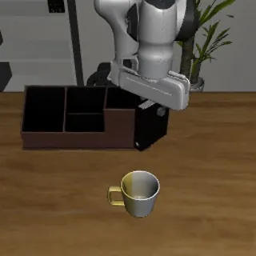

# LIBERO suite

All 130 tasks of [LIBERO](https://libero-project.github.io/) (Liu et al. 2023) on a Franka Panda in LIBERO's MuJoCo / robosuite scenes, in two task folders:

- `tasks/libero/` (suite `libero`, 40 tasks): LIBERO's four standard evaluation suites, LIBERO-Spatial, LIBERO-Object, LIBERO-Goal and LIBERO-Long (`libero_10`), 10 tasks each. Ids `libero-spatial-0` ... `libero-10-9`.
- `tasks/libero-90/` (suite `libero-90`, 90 tasks): LIBERO-90, the 90 short-horizon tasks in 20 kitchen, living-room and study scenes that LIBERO uses for pretraining. Ids `libero-90-0` ... `libero-90-89`.

Backend: `src/robouse/backends/libero.py`. Generator: `python adapters/libero/generate.py --root tasks` (writes both folders; `--suites libero_90` regenerates one LIBERO suite). Task ids use LIBERO's own task index in LIBERO's standard task order, so `libero-goal-4` is task 4 of `libero_goal`.



The suite exists so that learned VLA policies and LLM agent harnesses can be compared on the same Robo Use tasks: the same scene, initial state, step budget, success check, episode server and video pipeline. MolmoAct2 runs on it through the `molmoact2` harness ([molmoact2.md](../molmoact2.md)); every LLM harness in [harnesses.md](../harnesses.md) runs on it through `robo`.

## Source and licences

- LIBERO: [github.com/Lifelong-Robot-Learning/LIBERO](https://github.com/Lifelong-Robot-Learning/LIBERO), MIT licence ([LICENSE](https://github.com/Lifelong-Robot-Learning/LIBERO/blob/master/LICENSE), "Copyright (c) 2023 Lifelong Robot Learning"). The backend runs the `hf-libero` 0.1.4 packaging of it (the one LeRobot's LIBERO evaluation uses).
- Demonstrations: HF dataset [`yifengzhu-hf/LIBERO-datasets`](https://huggingface.co/datasets/yifengzhu-hf/LIBERO-datasets), Apache-2.0 (dataset card), pinned to revision `f13aa24a3da8c43c7225569f28c562979fa0e35a`. Only the initial state and the actions (or end-effector path) of one demonstration per task are copied into the task folder.
- Scene assets: HF dataset `lerobot/libero-assets` (downloaded at first use, or at image build in the hub runtime).

## Install

The backend uses `hf-libero` with `robosuite==1.4.0`. It runs on macOS (Apple M2 Max, `MUJOCO_GL=cgl`) and on Linux (`MUJOCO_GL=egl`, or `osmesa` in the hub image).

```
uv pip install --python .venv/bin/python --no-deps hf-libero==0.1.4 robosuite==1.4.0 bddl==1.0.1
uv pip install --python .venv/bin/python numba scipy opencv-python-headless termcolor easydict pyyaml huggingface_hub h5py fsspec tqdm matplotlib future
uv pip install --python .venv/bin/python torch --index-url https://download.pytorch.org/whl/cpu   # LIBERO loads its init-state files with torch
```

- `--no-deps` matters: `hf-libero` pins `robomimic`, `wandb`, `transformers` and `egl-probe` (which needs CMake), none of which the backend uses.
- LIBERO asks an interactive question the first time it is imported. The backend avoids it by writing `~/.libero/config.yaml` (or `$LIBERO_CONFIG_PATH/config.yaml`) itself if it is missing.
- The first episode downloads LIBERO's scene assets from the HF Hub into `~/.cache/libero/assets` (407 MB). The packages above add about 1 GB to the virtualenv, most of it torch.
- Tested with MuJoCo 3.3.0, numpy 2.5.3 and Python 3.12. `hf-libero` needs `mujoco<3.9`. A robosuite 1.5 install in the same environment would break this backend.

## Scoring and budgets

- `success_mode: first`, LIBERO's protocol: the episode ends as solved the first time LIBERO's `check_success()` (the task's BDDL goal predicates) is true, evaluated on the trusted side from the simulator state.
- Step budgets are LeRobot's per-suite LIBERO evaluation budgets (`TASK_SUITE_MAX_STEPS`): 280 (spatial, object), 300 (goal), 520 (libero_10), 400 (libero_90).
- Agent wall-clock limit: 1200 s (spatial, object, goal), 1800 s (libero_10), 1500 s (libero_90).
- Difficulty label: spatial and object easy, goal medium, libero_10 hard, libero_90 medium.

## Initial state and reference solution

LIBERO has no scripted experts, so each task's reference solution replays one human demonstration from LIBERO's own dataset (one hdf5 file per task, 50 demonstrations each). The adapter range-reads only `data/demo_k/states[0]` and `data/demo_k/actions` from the 1 GB+ hdf5 file over the HF Hub (about 2.5 s per demo). It does not download the file.

- The task's initial state (`robouse.init_state` in `task.md`, a flat MuJoCo state vector) is the demonstration's first state. After loading it, the robot holds still for 50 steps (`settle_steps`, as in LeRobot's MolmoAct2 evaluation) so objects come to rest. These steps are not counted.
- `oracle/demo_actions.json` holds the demonstration's actions. `oracle/solve.sh` replays them open-loop through the `robo` socket (`python -m robouse.oracle --backend libero`).
- The adapter replays each candidate in-process first and keeps the first demonstration (demo_0, demo_1, ... up to demo_49) whose replay reaches the success check. 114 tasks use demo_0 and 15 use demo_1 (the "Demo" column below). Picked demonstrations are cached in `~/.cache/robouse/libero-demos/`, so regenerating the task text skips the replays.
- One task, `libero-90-51` (LIVING_ROOM_SCENE2, "pick up the butter and put it in the basket"), has no demonstration that replays: all 50 were recorded with the robot about 14 cm further back relative to the scene than in the released scene (the recorded `ee_pos` at step 0 is x = -0.195, while the same joint state puts the hand at x = -0.055 today; the other four LIVING_ROOM_SCENE2 tasks match to 1 mm). An open-loop replay reaches past the butter. For this task the adapter instead tracks demo_0's recorded end-effector path: it closes the loop on the hand position (delta = remaining offset to the next recorded `ee_pos`, divided by the 5 cm action scale), keeps the demonstration's rotation and gripper commands, and saves the actions it took. The oracle replays those like any other task (success at step 149 of 400). `demo_actions.json` marks it with `"method": "tracked end-effector path"`.

Caveat: these initial states come from LIBERO's training demonstrations, not from LIBERO's 50 fixed evaluation init states per task. Policies trained on LIBERO demonstrations, including MolmoAct2-LIBERO (trained on LeRobot's re-rendered copy of the same demonstrations), have therefore seen these exact starting layouts in training. For the LIBERO evaluation states, drop `init_state` from a task: the backend then loads LIBERO's benchmark init state number `seed`. There is no reference solution for those states.

## Action and observation

Action: `robo act DX DY DZ DROLL DPITCH DYAW GRIPPER`, each in [-1, 1]. This is LIBERO's own 7-D delta end-effector command for robosuite's OSC_POSE controller at 20 Hz.

- 1.0 on DX/DY/DZ asks for 5 cm per step. The arm lags behind the request, and holding an axis at 1.0 moves the hand about 1 cm per step (measured: 4.4-5.9 cm over 5 steps).
- DROLL/DPITCH/DYAW: 1.0 asks for 0.5 rad.
- GRIPPER: -1 opens, +1 closes.
- The `move_to`/`grip` skills work. They send `[dx, dy, dz, grip]`, which the backend pads with zero rotation.

World frame, in metres: +x forward, away from the robot base; +y to the robot's left; +z up. The work surface height depends on the LIBERO scene class, and each instruction states it: about z = 0.90 for the kitchen tables (LIBERO-Spatial, -Goal and the kitchen scenes), 0.43 for the living-room tables, 0.88 for the study desks, and 0.0 for LIBERO-Object, whose objects stand on the floor.

| Field | Meaning |
|---|---|
| hand_pos | end-effector position (`robot0_eef_pos`) |
| eef_quat, eef_axis_angle | end-effector orientation, quaternion (x, y, z, w) and axis-angle |
| gripper_qpos | the two finger joint positions |
| gripper_open | finger gap in metres (about 0.08 fully open) |
| objects | `{name: {pos, quat}}` for every object in LIBERO's observation (e.g. `akita_black_bowl_1`, `plate_1`) |
| fixtures | `{name: {pos, quat}}` for every fixture (cabinet, stove, microwave, rack, shelf, ...) |
| articulated | `{joint name: {qpos, range, open_ranges / close_ranges or turnon_ranges / turnoff_ranges, box_min, box_max}}` for every movable fixture part (drawer slide, door hinge, stove knob): joint position, joint limits, the thresholds LIBERO's Open / Close / TurnOn / TurnOff predicates use for that fixture, and the world-frame bounding box of the moving part |

`fixtures` and `articulated` are new in this version. Before, drawers, doors and stove knobs were not in the state observation at all: in the 25 tasks that open, close, turn on or turn off a fixture the agent had to locate and judge the part from camera images.

Cameras: `agentview` (front, the default and the video camera) and `robot0_eye_in_hand` (wrist). Both are 256x256 and saved upright. robosuite renders them upside down, and the backend flips them. `mj_model_data` is provided, so a vision-mode variant (`obs_mode: vision`) would get projection matrices. The shipped tasks use `obs_mode: state`.

Speed on the Mac: about 40 ms per simulated step, including rendering both cameras. Creating an environment takes about 5 s after the first run. An oracle episode takes 18 s on average through the local runner.

## Tasks: LIBERO-Spatial, -Object, -Goal and -Long (`tasks/libero`)

| Task id | LIBERO suite | Instruction | Demo | Oracle steps | Budget |
|---|---|---|---|---|---|
| libero-spatial-0 | libero_spatial | pick up the black bowl between the plate and the ramekin and place it on the plate | demo_0 | 80 | 280 |
| libero-spatial-1 | libero_spatial | pick up the black bowl next to the ramekin and place it on the plate | demo_0 | 107 | 280 |
| libero-spatial-2 | libero_spatial | pick up the black bowl from table center and place it on the plate | demo_0 | 92 | 280 |
| libero-spatial-3 | libero_spatial | pick up the black bowl on the cookie box and place it on the plate | demo_0 | 88 | 280 |
| libero-spatial-4 | libero_spatial | pick up the black bowl in the top drawer of the wooden cabinet and place it on the plate | demo_0 | 115 | 280 |
| libero-spatial-5 | libero_spatial | pick up the black bowl on the ramekin and place it on the plate | demo_0 | 121 | 280 |
| libero-spatial-6 | libero_spatial | pick up the black bowl next to the cookie box and place it on the plate | demo_1 | 125 | 280 |
| libero-spatial-7 | libero_spatial | pick up the black bowl on the stove and place it on the plate | demo_1 | 115 | 280 |
| libero-spatial-8 | libero_spatial | pick up the black bowl next to the plate and place it on the plate | demo_0 | 101 | 280 |
| libero-spatial-9 | libero_spatial | pick up the black bowl on the wooden cabinet and place it on the plate | demo_0 | 126 | 280 |
| libero-object-0 | libero_object | pick up the alphabet soup and place it in the basket | demo_0 | 121 | 280 |
| libero-object-1 | libero_object | pick up the cream cheese and place it in the basket | demo_0 | 128 | 280 |
| libero-object-2 | libero_object | pick up the salad dressing and place it in the basket | demo_1 | 113 | 280 |
| libero-object-3 | libero_object | pick up the bbq sauce and place it in the basket | demo_0 | 124 | 280 |
| libero-object-4 | libero_object | pick up the ketchup and place it in the basket | demo_1 | 145 | 280 |
| libero-object-5 | libero_object | pick up the tomato sauce and place it in the basket | demo_0 | 121 | 280 |
| libero-object-6 | libero_object | pick up the butter and place it in the basket | demo_0 | 158 | 280 |
| libero-object-7 | libero_object | pick up the milk and place it in the basket | demo_0 | 139 | 280 |
| libero-object-8 | libero_object | pick up the chocolate pudding and place it in the basket | demo_0 | 158 | 280 |
| libero-object-9 | libero_object | pick up the orange juice and place it in the basket | demo_0 | 115 | 280 |
| libero-goal-0 | libero_goal | open the middle drawer of the cabinet | demo_0 | 127 | 300 |
| libero-goal-1 | libero_goal | put the bowl on the stove | demo_0 | 83 | 300 |
| libero-goal-2 | libero_goal | put the wine bottle on top of the cabinet | demo_0 | 82 | 300 |
| libero-goal-3 | libero_goal | open the top drawer and put the bowl inside | demo_0 | 160 | 300 |
| libero-goal-4 | libero_goal | put the bowl on top of the cabinet | demo_0 | 81 | 300 |
| libero-goal-5 | libero_goal | push the plate to the front of the stove | demo_0 | 144 | 300 |
| libero-goal-6 | libero_goal | put the cream cheese in the bowl | demo_0 | 76 | 300 |
| libero-goal-7 | libero_goal | turn on the stove | demo_0 | 70 | 300 |
| libero-goal-8 | libero_goal | put the bowl on the plate | demo_0 | 69 | 300 |
| libero-goal-9 | libero_goal | put the wine bottle on the rack | demo_0 | 140 | 300 |
| libero-10-0 | libero_10 | put both the alphabet soup and the tomato sauce in the basket | demo_1 | 293 | 520 |
| libero-10-1 | libero_10 | put both the cream cheese box and the butter in the basket | demo_0 | 247 | 520 |
| libero-10-2 | libero_10 | turn on the stove and put the moka pot on it | demo_0 | 260 | 520 |
| libero-10-3 | libero_10 | put the black bowl in the bottom drawer of the cabinet and close it | demo_1 | 217 | 520 |
| libero-10-4 | libero_10 | put the white mug on the left plate and put the yellow and white mug on the right plate | demo_0 | 226 | 520 |
| libero-10-5 | libero_10 | pick up the book and place it in the back compartment of the caddy | demo_0 | 224 | 520 |
| libero-10-6 | libero_10 | put the white mug on the plate and put the chocolate pudding to the right of the plate | demo_0 | 193 | 520 |
| libero-10-7 | libero_10 | put both the alphabet soup and the cream cheese box in the basket | demo_0 | 231 | 520 |
| libero-10-8 | libero_10 | put both moka pots on the stove | demo_0 | 448 | 520 |
| libero-10-9 | libero_10 | put the yellow and white mug in the microwave and close it | demo_1 | 238 | 520 |

## Tasks: LIBERO-90 (`tasks/libero-90`)

Budget 400 steps for all. The scene is the prefix of LIBERO's task name.

| Task id | Scene | Instruction | Demo | Oracle steps |
|---|---|---|---|---|
| libero-90-0 | KITCHEN_SCENE10 | close the top drawer of the cabinet | demo_0 | 59 |
| libero-90-1 | KITCHEN_SCENE10 | close the top drawer of the cabinet and put the black bowl on top of it | demo_0 | 187 |
| libero-90-2 | KITCHEN_SCENE10 | put the black bowl in the top drawer of the cabinet | demo_0 | 105 |
| libero-90-3 | KITCHEN_SCENE10 | put the butter at the back in the top drawer of the cabinet and close it | demo_0 | 172 |
| libero-90-4 | KITCHEN_SCENE10 | put the butter at the front in the top drawer of the cabinet and close it | demo_0 | 162 |
| libero-90-5 | KITCHEN_SCENE10 | put the chocolate pudding in the top drawer of the cabinet and close it | demo_0 | 157 |
| libero-90-6 | KITCHEN_SCENE1 | open the bottom drawer of the cabinet | demo_0 | 113 |
| libero-90-7 | KITCHEN_SCENE1 | open the top drawer of the cabinet | demo_0 | 166 |
| libero-90-8 | KITCHEN_SCENE1 | open the top drawer of the cabinet and put the bowl in it | demo_0 | 178 |
| libero-90-9 | KITCHEN_SCENE1 | put the black bowl on the plate | demo_0 | 116 |
| libero-90-10 | KITCHEN_SCENE1 | put the black bowl on top of the cabinet | demo_0 | 153 |
| libero-90-11 | KITCHEN_SCENE2 | open the top drawer of the cabinet | demo_0 | 54 |
| libero-90-12 | KITCHEN_SCENE2 | put the black bowl at the back on the plate | demo_0 | 87 |
| libero-90-13 | KITCHEN_SCENE2 | put the black bowl at the front on the plate | demo_0 | 123 |
| libero-90-14 | KITCHEN_SCENE2 | put the middle black bowl on the plate | demo_0 | 89 |
| libero-90-15 | KITCHEN_SCENE2 | put the middle black bowl on top of the cabinet | demo_0 | 126 |
| libero-90-16 | KITCHEN_SCENE2 | stack the black bowl at the front on the black bowl in the middle | demo_0 | 99 |
| libero-90-17 | KITCHEN_SCENE2 | stack the middle black bowl on the back black bowl | demo_0 | 117 |
| libero-90-18 | KITCHEN_SCENE3 | put the frying pan on the stove | demo_0 | 162 |
| libero-90-19 | KITCHEN_SCENE3 | put the moka pot on the stove | demo_0 | 125 |
| libero-90-20 | KITCHEN_SCENE3 | turn on the stove | demo_0 | 77 |
| libero-90-21 | KITCHEN_SCENE3 | turn on the stove and put the frying pan on it | demo_1 | 229 |
| libero-90-22 | KITCHEN_SCENE4 | close the bottom drawer of the cabinet | demo_0 | 108 |
| libero-90-23 | KITCHEN_SCENE4 | close the bottom drawer of the cabinet and open the top drawer | demo_1 | 181 |
| libero-90-24 | KITCHEN_SCENE4 | put the black bowl in the bottom drawer of the cabinet | demo_0 | 155 |
| libero-90-25 | KITCHEN_SCENE4 | put the black bowl on top of the cabinet | demo_0 | 134 |
| libero-90-26 | KITCHEN_SCENE4 | put the wine bottle in the bottom drawer of the cabinet | demo_0 | 105 |
| libero-90-27 | KITCHEN_SCENE4 | put the wine bottle on the wine rack | demo_0 | 221 |
| libero-90-28 | KITCHEN_SCENE5 | close the top drawer of the cabinet | demo_0 | 55 |
| libero-90-29 | KITCHEN_SCENE5 | put the black bowl in the top drawer of the cabinet | demo_0 | 110 |
| libero-90-30 | KITCHEN_SCENE5 | put the black bowl on the plate | demo_0 | 103 |
| libero-90-31 | KITCHEN_SCENE5 | put the black bowl on top of the cabinet | demo_0 | 137 |
| libero-90-32 | KITCHEN_SCENE5 | put the ketchup in the top drawer of the cabinet | demo_1 | 189 |
| libero-90-33 | KITCHEN_SCENE6 | close the microwave | demo_0 | 225 |
| libero-90-34 | KITCHEN_SCENE6 | put the yellow and white mug to the front of the white mug | demo_0 | 104 |
| libero-90-35 | KITCHEN_SCENE7 | open the microwave | demo_0 | 122 |
| libero-90-36 | KITCHEN_SCENE7 | put the white bowl on the plate | demo_0 | 211 |
| libero-90-37 | KITCHEN_SCENE7 | put the white bowl to the right of the plate | demo_0 | 109 |
| libero-90-38 | KITCHEN_SCENE8 | put the right moka pot on the stove | demo_0 | 182 |
| libero-90-39 | KITCHEN_SCENE8 | turn off the stove | demo_1 | 105 |
| libero-90-40 | KITCHEN_SCENE9 | put the frying pan on the cabinet shelf | demo_0 | 166 |
| libero-90-41 | KITCHEN_SCENE9 | put the frying pan on top of the cabinet | demo_0 | 167 |
| libero-90-42 | KITCHEN_SCENE9 | put the frying pan under the cabinet shelf | demo_0 | 160 |
| libero-90-43 | KITCHEN_SCENE9 | put the white bowl on top of the cabinet | demo_0 | 125 |
| libero-90-44 | KITCHEN_SCENE9 | turn on the stove | demo_0 | 111 |
| libero-90-45 | KITCHEN_SCENE9 | turn on the stove and put the frying pan on it | demo_0 | 242 |
| libero-90-46 | LIVING_ROOM_SCENE1 | pick up the alphabet soup and put it in the basket | demo_0 | 144 |
| libero-90-47 | LIVING_ROOM_SCENE1 | pick up the cream cheese box and put it in the basket | demo_0 | 150 |
| libero-90-48 | LIVING_ROOM_SCENE1 | pick up the ketchup and put it in the basket | demo_0 | 163 |
| libero-90-49 | LIVING_ROOM_SCENE1 | pick up the tomato sauce and put it in the basket | demo_0 | 151 |
| libero-90-50 | LIVING_ROOM_SCENE2 | pick up the alphabet soup and put it in the basket | demo_0 | 155 |
| libero-90-51 | LIVING_ROOM_SCENE2 | pick up the butter and put it in the basket | demo_0 (tracked) | 149 |
| libero-90-52 | LIVING_ROOM_SCENE2 | pick up the milk and put it in the basket | demo_0 | 93 |
| libero-90-53 | LIVING_ROOM_SCENE2 | pick up the orange juice and put it in the basket | demo_0 | 137 |
| libero-90-54 | LIVING_ROOM_SCENE2 | pick up the tomato sauce and put it in the basket | demo_0 | 93 |
| libero-90-55 | LIVING_ROOM_SCENE3 | pick up the alphabet soup and put it in the tray | demo_0 | 100 |
| libero-90-56 | LIVING_ROOM_SCENE3 | pick up the butter and put it in the tray | demo_0 | 92 |
| libero-90-57 | LIVING_ROOM_SCENE3 | pick up the cream cheese and put it in the tray | demo_0 | 147 |
| libero-90-58 | LIVING_ROOM_SCENE3 | pick up the ketchup and put it in the tray | demo_0 | 132 |
| libero-90-59 | LIVING_ROOM_SCENE3 | pick up the tomato sauce and put it in the tray | demo_0 | 117 |
| libero-90-60 | LIVING_ROOM_SCENE4 | pick up the black bowl on the left and put it in the tray | demo_0 | 98 |
| libero-90-61 | LIVING_ROOM_SCENE4 | pick up the chocolate pudding and put it in the tray | demo_0 | 140 |
| libero-90-62 | LIVING_ROOM_SCENE4 | pick up the salad dressing and put it in the tray | demo_0 | 103 |
| libero-90-63 | LIVING_ROOM_SCENE4 | stack the left bowl on the right bowl and place them in the tray | demo_0 | 187 |
| libero-90-64 | LIVING_ROOM_SCENE4 | stack the right bowl on the left bowl and place them in the tray | demo_0 | 221 |
| libero-90-65 | LIVING_ROOM_SCENE5 | put the red mug on the left plate | demo_1 | 133 |
| libero-90-66 | LIVING_ROOM_SCENE5 | put the red mug on the right plate | demo_0 | 167 |
| libero-90-67 | LIVING_ROOM_SCENE5 | put the white mug on the left plate | demo_0 | 77 |
| libero-90-68 | LIVING_ROOM_SCENE5 | put the yellow and white mug on the right plate | demo_0 | 110 |
| libero-90-69 | LIVING_ROOM_SCENE6 | put the chocolate pudding to the left of the plate | demo_0 | 99 |
| libero-90-70 | LIVING_ROOM_SCENE6 | put the chocolate pudding to the right of the plate | demo_0 | 66 |
| libero-90-71 | LIVING_ROOM_SCENE6 | put the red mug on the plate | demo_0 | 106 |
| libero-90-72 | LIVING_ROOM_SCENE6 | put the white mug on the plate | demo_0 | 137 |
| libero-90-73 | STUDY_SCENE1 | pick up the book and place it in the front compartment of the caddy | demo_0 | 164 |
| libero-90-74 | STUDY_SCENE1 | pick up the book and place it in the left compartment of the caddy | demo_1 | 140 |
| libero-90-75 | STUDY_SCENE1 | pick up the book and place it in the right compartment of the caddy | demo_1 | 146 |
| libero-90-76 | STUDY_SCENE1 | pick up the yellow and white mug and place it to the right of the caddy | demo_0 | 118 |
| libero-90-77 | STUDY_SCENE2 | pick up the book and place it in the back compartment of the caddy | demo_0 | 181 |
| libero-90-78 | STUDY_SCENE2 | pick up the book and place it in the front compartment of the caddy | demo_0 | 123 |
| libero-90-79 | STUDY_SCENE2 | pick up the book and place it in the left compartment of the caddy | demo_0 | 97 |
| libero-90-80 | STUDY_SCENE2 | pick up the book and place it in the right compartment of the caddy | demo_0 | 150 |
| libero-90-81 | STUDY_SCENE3 | pick up the book and place it in the front compartment of the caddy | demo_0 | 133 |
| libero-90-82 | STUDY_SCENE3 | pick up the book and place it in the left compartment of the caddy | demo_0 | 149 |
| libero-90-83 | STUDY_SCENE3 | pick up the book and place it in the right compartment of the caddy | demo_0 | 110 |
| libero-90-84 | STUDY_SCENE3 | pick up the red mug and place it to the right of the caddy | demo_0 | 109 |
| libero-90-85 | STUDY_SCENE3 | pick up the white mug and place it to the right of the caddy | demo_0 | 102 |
| libero-90-86 | STUDY_SCENE4 | pick up the book in the middle and place it on the cabinet shelf | demo_0 | 156 |
| libero-90-87 | STUDY_SCENE4 | pick up the book on the left and place it on top of the shelf | demo_1 | 130 |
| libero-90-88 | STUDY_SCENE4 | pick up the book on the right and place it on the cabinet shelf | demo_0 | 82 |
| libero-90-89 | STUDY_SCENE4 | pick up the book on the right and place it under the cabinet shelf | demo_0 | 112 |

## Validation

Local runner, concurrency 3, on the Mac:

| Harness | libero (40) | libero-90 (90) | Jobs |
|---|---|---|---|
| oracle | 40/40 | 90/90 | `runs/libero-oracle`, `runs/libero-90-oracle` |
| noop | 0/40 | 0/90 | `runs/libero-noop`, `runs/libero-90-noop` |

Hub runtime `libero` (`templates/runtimes/libero`, unchanged; linux/arm64 under Colima, MuJoCo on OSMesa, no network in the simulator container), from a scratch export of both datasets with the released `bench` 0.7.4:

- oracle 9/9: libero-90-0, libero-90-33, libero-90-46, libero-90-51 (the tracked one), libero-90-73, libero-spatial-1, libero-object-3, libero-goal-5, libero-10-9. The first attempt passed 6 and lost 3 to the shared VM, not to the tasks: two `docker compose up` failures ("No such container") and one simulator killed by memory pressure at step 128 (exit 137). All three passed on a rerun at concurrency 1.
- no-op 0/2 (libero-90-20, libero-90-86, reference solution replaced by BenchFlow's look-only no-op).
- Image: 4.05 GB on disk (1.02 GB content). Per trial on the shared VM: environment setup 46-277 s (the compose build is served from the build cache, but the VM was busy), oracle episode plus verifier 25-60 s.

## Model probe

Kimi K3 (`moonshotai/Kimi-K3` on Baseten) through the `claude-code-glm` harness, task list `task-lists/libero-probe.txt`, job `runs/libero-probe-kimi`, concurrency 3. Informative only.

| Task | Instruction | Result | Steps | Wall time |
|---|---|---|---|---|
| libero-90-33 | close the microwave | solved | 54 / 400 | 233 s |
| libero-goal-7 | turn on the stove | agent timeout (1200 s) | 216 / 300 | 1214 s |
| libero-10-3 | put the black bowl in the bottom drawer of the cabinet and close it | agent timeout (1800 s) | 485 / 520 | 1818 s |

The trajectories show the new `articulated` field in use and no instruction problem. On libero-90-33 the agent pushed the open microwave door shut with three `move-to` calls, the last one sweeping the closed gripper through the door's bounding box. On libero-goal-7 it went to the knob's bounding box, grasped and turned the knob, and watched `qpos` rise to 0.398 of the 0.5 needed before its wall-clock limit ran out. On libero-10-3 it moved the bowl but did not get it into the open bottom drawer in time.

## Earlier results (Robo Use LIBERO 0.1, the 20 tasks with even LIBERO indices)

| Harness | Model | Solved | Job |
|---|---|---|---|
| molmoact2 | allenai/MolmoAct2-LIBERO-LeRobot | 20/20 (see [molmoact2.md](../molmoact2.md) for caveats) | `runs/final-libero-molmoact2` |
| claude-code | claude-opus-5-5 | 1/1 smoke trial (libero-goal-8, 279 of 300 steps) | `runs/smoke-libero-claude` |

Those runs used the 0.1 instructions: the same initial states, reference solutions and success checks, but without the `fixtures` / `articulated` observation fields, and with the table height given as z = 0.90 for every scene (wrong for the LIBERO-Object floor scene and the living-room scenes of LIBERO-Long).

## Changes from 0.1

- 20 -> 130 tasks. The 20 existing ids keep their initial state, demonstration and reference solution; regenerating them with the pinned dataset revision gives byte-identical `demo_actions.json` and `init_state`.
- Instruction fixes that change the text of existing tasks: the per-scene surface height (8 of the 20: every LIBERO-Object task and libero-10-0, -4, -6), and the new `fixtures` / `articulated` fields in the observation list (all tasks).
- Nothing was dropped: every LIBERO task has a working reference solution.
