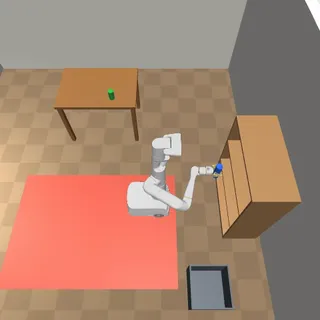

# Mobile-manip suite (Stretch 3, TIAGo and Google Robot in an apartment)

The mobile-manip suite has 10 tasks in `tasks/mobile-manip/`: three mobile manipulators fetch objects between rooms, open a kitchen drawer, put things into it, on a bookshelf or into a bin.

- Backend: `src/robouse/backends/mobile_manip.py` (tasks, embodiment declarations, control step, monitor, judge, skills). Scene and robot controllers: `src/robouse/backends/mobile_manip_sim/` (`apartment.py`, `robots.py`); reference solutions: `mobile_manip_sim/oracles.py`.
- Generator: `python adapters/mobile-manip/generate.py`.
- Shared embodiment base: `src/robouse/backends/embodied.py`.

## Robots and licences

All three come from MuJoCo Menagerie at the pinned commit `8161bba2...` (fetched with `robouse fetch-assets --robot NAME`; hashes in `assets/menagerie/embodiments.json`). All are Apache-2.0.

| Robot | Menagerie folder | Used as | Changes |
|---|---|---|---|
| Hello Robot Stretch 3 | `hello_robot_stretch_3` (`stretch.xml`) | differential drive, lift, telescoping arm, wrist yaw/pitch/roll, SG3 gripper, head cameras | wheel velocity ctrlrange widened from +-6 to +-15 (0.1 to 0.25 m/s); a grasp site where the fingertips meet |
| PAL TIAGo | `pal_tiago` (`tiago_position.xml`) | differential drive, torso lift, 7-joint arm, parallel gripper, head camera | finger meshes are visual only; each finger collides through a flat pad box on its inner face (friction 2) |
| Google Robot | `google_robot` (`robot.xml`) | 7-joint arm and gripper on an added planar base | upstream the base is fixed to the world (nq = 9); we add slide x, slide y and hinge yaw joints on the root with force-limited velocity actuators (a holonomic abstraction: it can move sideways, the real robot cannot), lift the base 3 mm so the wheels do not touch the floor, and add a head camera |

Masses, inertias, joint ranges and the upstream position/velocity actuators are otherwise kept. The parent MjSpec is compiled with `degree = False`: attaching a radian-unit Menagerie model into a default (degree) MjSpec silently rescales its joint ranges.

## Scene

An 8 m x 5 m apartment (x -4..4, y -2.5..2.5; +x east, +y north, +z up) with 2 m walls:

- Living room (x 0..4): dining table (1.0 x 0.7 m, 0.75 m, centred (2.0, 1.3)), sofa, bookshelf against the east wall (shelves at z 0.40 and 0.80, open to the west), waste bin (0.4 x 0.4 x 0.35 m at (3.3, -1.0), fixed).
- Kitchen (x -4..0, y 0..2.5): counter along the north wall (front y = 1.85, top z = 0.9) with a drawer: a body on a slide joint (travel 0.40 m, damping 6 N s/m, friction 2 N), a vertical bar handle at (-2.0, 1.78, 0.77); kitchen table (0.7 x 0.5 m at (-3.35, 0.55)).
- Study (x -4..0, y -2.5..0): desk against the south wall (1.2 x 0.6 m at (-2.4, -2.15)).
- A wall at x = 0 with 1 m doorways at (0, 1.4) and (0, -1.4); a solid wall at y = 0 between kitchen and study.

Objects are free bodies with realistic sizes and masses: can (0.066 x 0.122 m, 0.35 kg), bottle (0.064 x 0.20 m, 0.36 kg), cup (0.08 x 0.095 m, 0.25 kg), box (0.10 x 0.05 x 0.14 m, 0.2 kg), spice box (0.06 x 0.04 x 0.10 m, 0.12 kg). Every position is public under `apartment` and `objects` in `robo observe`.

Physics: 2 ms steps, implicitfast, elliptic friction cones, impratio 10, 3 noslip iterations (the upstream Stretch settings; without noslip, objects creep out of friction grasps), multi-point convex contacts. One control step is 50 ms. Nothing is welded or teleported: grasps are friction only.

## Action groups and controllers

Zero holds everything. `robo info` shows the declaration under `embodiment`.

| Robot | Action (one 50 ms step, each value in [-1, 1]) |
|---|---|
| Stretch | `base.twist` [V, WZ] (x 0.25 m/s, x 60 deg/s); `arm.lift` [DLIFT] (target = measured + x 2 cm); `arm.extend` [DEXT] (measured + x 4 cm); `wrist` [DYAW, DPITCH] (measured + x 15 deg); `arm.posture` [POSE]; `gripper` [G] |
| TIAGo | `base.twist` [V, WZ] (x 0.45 m/s, x 60 deg/s); `arm.ee_delta` [DX, DY, DZ] (world frame, x 2 cm); `arm.posture` [POSE]; `gripper` [G] |
| Google Robot | `base.twist` [VX, VY, WZ] (robot frame, x 0.5 m/s, x 60 deg/s); `arm.ee_delta` [DX, DY, DZ]; `arm.posture` [POSE]; `gripper` [G] |

- Differential drive (Stretch, TIAGo): the twist is acceleration-limited, turned into wheel speeds from the model's wheel radius and track, and sent to the upstream wheel velocity actuators; the base moves by wheel-floor friction.
- Planar base (Google Robot): the robot-frame twist becomes world-frame joint velocities for the added velocity actuators (force limits 500 N, 150 N m), so walls stop it.
- IK arm (TIAGo, Google Robot): the gripper target is kept in the robot frame (it moves with the base); each step, damped-least-squares IK (weighted, with joint-limit locking and a posture term; TIAGo includes the torso lift) solves for the target with a fixed gripper orientation (pointing along the heading, level, fingers closing horizontally). The IK runs on a scratch copy with the base level, plus a low-pass of the base's static tilt, so a rocking base does not feed back into the arm. Joint setpoints are slewed at 1.2 rad/s and get a joint-space integral term near rest (the Google Robot's upstream servos are soft: kp 10 to 40).
- Stretch arm: lift, telescope and wrist targets are set relative to the measured joint position, with an integral term on lift and telescope (joint friction, payload, a drawer's resistance).
- `arm.posture`: +1 ready pose, -1 stowed pose (joint-space moves; Stretch unfolds its wrist in stages). Grippers: G > 0 closes, < 0 opens; the target stays within a margin of the measured fingers, so a grasp squeezes with a bounded force (TIAGo's upstream finger force limit is 5.2 N).

## Skills

`drive_to X Y [YAW_DEG] [TOL]` (diff drive: turn, straight line with heading correction and a braking profile, final turn; Google: straight holonomic line while turning; not obstacle-aware, stops and reports when the base is blocked), `turn YAW_DEG`, `reach X Y Z` (IK arms: straight-line target motion then convergence, reports the error and contacts; Stretch: lift to the height, drive the base along its heading to put the point on the arm's line, extend; reports out-of-range points), `grasp` (close until the fingers stop; reports what is held), `open_gripper`, `ready`, `stow`. Skills yield ordinary actions, so their steps count and they can fail. Step caps per call: `drive_to` 1000 (Google Robot 700), `reach` 800 (Stretch; 300 for the IK arms), `turn` 200, `ready`/`stow` 200. `drive_to` rejects a non-finite YAW_DEG.

## Observation and cameras

`robot` (base pose and velocity, gripper point, opening, `holding`, `touching`, arm posture, Stretch joint values or the IK target), `objects` (kind, colour, centre, tilt, `resting_on`, size, mass), `apartment` (rooms, doorways, furniture, the drawer's `opening_m` and handle) and `safety_events`. Cameras: `chase` (default, follows the robot from above and behind, looking north), the robot's own `robot/head` (Stretch also `robot/wrist`), `overview`, `living_room_cam`, `kitchen_cam`, `study_cam`.

## Judge and events

Placement on a table or shelf: the object touches that surface, its centre is above it, it is tilted less than 20 degrees and the robot does not touch it. Bin: centre inside the bin walls, below the rim, not touched by the robot. Drawer: centre inside the drawer (at most 5 cm above its walls), touching it, not touched by the robot. Drawer tasks: `opening_m` of at least 0.25 and no part of the robot touching the drawer (the handle has been let go). Any safety event fails a task: a contact force above 150 N between a wall, furniture or the drawer and the robot's base or body (base, wheels, mast or torso, head), or above 400 N for the arm and gripper (checked every 2 ms physics step; the fingers are exempt only on the drawer, which they grip and pull); a task object touching the floor (outside the bin); a cylinder knocked over (tilt > 60 degrees) on a table, shelf or counter; the base tilting more than 12 degrees (Stretch and TIAGo; the Google Robot's planar base cannot tilt).

## Tasks

| Task | Robot | Goal | Success | Budget |
|---|---|---|---|---|
| stretch-fetch-cup | Stretch 3 | cup from the study desk to the dining table (route through the study doorway) | cup stands on the dining table | 4000 |
| stretch-open-drawer | Stretch 3 | open the kitchen drawer | opening >= 0.25 m, robot not touching the drawer | 2400 |
| stretch-shelve-two | Stretch 3 | can and box from the dining table onto the bookshelf | both stand on a shelf | 5000 |
| tiago-fetch-juice | TIAGo | juice box from the kitchen counter to the dining table | box stands on the dining table | 3600 |
| tiago-drawer-stow | TIAGo | put the spice box (on the counter) into the closed drawer: open it first | box inside the drawer | 3000 |
| tiago-bin-cans | TIAGo | red and green cans from the dining table into the bin, leave the cup | both cans in the bin, cup still on the table | 4000 |
| tiago-study-to-kitchen | TIAGo | mug from the study desk to the kitchen table (no door between them: through the living room) | mug stands on the kitchen table | 3600 |
| google-fetch-can | Google Robot | can from the kitchen table to the dining table | can stands on the dining table | 2600 |
| google-open-drawer | Google Robot | open the kitchen drawer | opening >= 0.25 m, robot not touching the drawer | 1400 |
| google-sort-bottle-can | Google Robot | bottle to the upper shelf, can into the bin | both in place | 3600 |

Every success also requires no safety event.

## Validation

Real runner, 2026-09-28, MuJoCo 3.3.0, concurrency 3:

| Harness | Result | Runs |
|---|---|---|
| oracle | 10/10 | `runs/emb-oracle-mobile-manip-v2/` |
| noop | 0/10 | `runs/emb-noop-mobile-manip-v2/` |

Oracle episodes use 628 to 2885 steps and 3 to 25 s of episode wall time on an unloaded run; in the v2 run three trials that ran at the same moment took about 15 minutes each while the machine was saturated by other jobs (load average near 70), which happened in earlier runs of other suites too. The reference solutions use only `robo observe` fields, `robo act` and the skills, with waypoints through the doorways. Scripted wrong attempts score 0: pulling the drawer only 0.13 m; opening it fully but still holding the handle; bringing the cup to the table without letting go; throwing the cup into the bin as well; dropping the juice box; putting the can on the floor next to the dining table; driving TIAGo (0.45 m/s), Stretch (0.25 m/s) or the Google Robot (0.5 m/s) into a wall (184 to 2452 N, a crash).

## Limitations

- The Google Robot's base is a holonomic abstraction (the real one is a two-wheel differential drive); its wheels do not touch the floor.
- The IK arms keep the gripper level and pointing along the heading: no top-down grasps and no wrist roll. Stretch's wrist roll and head are not in the action.
- TIAGo's finger collision is a flat pad box per finger, not the upstream finger mesh; its upstream 5.2 N finger force limit makes heavier or taller objects slip, so its tasks use cans, boxes and a mug.
- The Google Robot's upstream servos are soft; the arm settles in about a second and can sag or bump furniture with the elbow.
- No doors (hinged doors were left out), no sensor noise; state is exact. The scene is fixed (seed 0).
