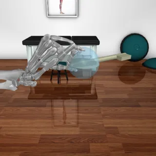

# MyoSuite suite (muscle-driven human elbow, finger and hand)

The MyoSuite suite has 15 tasks in `tasks/myosuite/`, adapted from [MyoSuite](https://github.com/MyoHub/myosuite) (MyoHub; Caggiano et al., "MyoSuite: A contact-rich simulation suite for musculoskeletal motor control", L4DC 2022). The robot is a human musculoskeletal model: an elbow with 6 muscles, an index finger with 5 muscles, or a hand and forearm with 23 joints and 39 muscles. The agent drives it through muscle excitations, or through a muscle-space joint controller skill, and each task is judged by MyoSuite's own `solved` check for that env.

- Backend: `src/robouse/backends/myosuite_backend.py` (embodiment declaration, skills, judge, task table, reference solutions).
- Simulator worker: `src/robouse/backends/myosuite_worker.py` (runs in MyoSuite's own virtualenv; env, muscle-space controller, inverse kinematics, observation, rendering).
- Generator: `python adapters/myosuite/generate.py` (needs the MyoSuite virtualenv, and torch in the calling environment to read MyoSuite's NPG baseline pickles for the policy-driven reference solutions).



## Source and licences

- Code: [MyoHub/myosuite](https://github.com/MyoHub/myosuite), Apache-2.0 ([LICENSE](https://github.com/MyoHub/myosuite/blob/main/LICENSE)), PyPI release `myosuite==2.12.2` (wheel SHA-256 `bec0133d9d4ba0249aeccdd7de632eead4749436ffb4e5a3c44a8f9cedafd9ea`).
- Models: [MyoHub/myo_sim](https://github.com/MyoHub/myo_sim) (MyoSim 0.1.0), Apache-2.0 ([LICENSE](https://github.com/MyoHub/myo_sim/blob/main/LICENSE)); the other model repositories MyoSuite bundles ([furniture_sim](https://github.com/vikashplus/furniture_sim), [object_sim](https://github.com/vikashplus/object_sim), [MPL_sim](https://github.com/vikashplus/MPL_sim), [YCB_sim](https://github.com/vikashplus/YCB_sim)) are Apache-2.0 too. All of them ship inside the myosuite wheel (`myosuite/simhive`, each with its LICENSE file), so nothing is downloaded at run time.
- Reference-solution policies for three tasks: MyoSuite's NPG baselines (`myosuite/agents/baslines_NPG`, part of the Apache-2.0 package), converted to plain JSON weights in the task's `oracle/policy.json`.

Licences allow redistribution and use in a public benchmark (Apache-2.0 keeps the notices; the hub image installs the unmodified wheel).

## Setup

MyoSuite 2.12.2 pins MuJoCo 3.6 and gymnasium < 1.3, which conflict with the Robo Use environment (MuJoCo 3.3.0, gymnasium 1.3.0), so it runs in its own virtualenv as a subprocess of the episode server that speaks JSON lines (the DexJoCo and driving pattern).

```
uv venv -p 3.11 ~/.cache/robouse/myosuite-venv
uv pip install -p ~/.cache/robouse/myosuite-venv/bin/python myosuite==2.12.2 scipy==1.16.2
```

- The backend looks for `~/.cache/robouse/myosuite-venv/bin/python`; override with `ROBOUSE_MYOSUITE_PYTHON`. Set `ROBOUSE_MYOSUITE_QUIET=0` to see the worker's stderr. The full frozen environment is in the hub runtime (`templates/runtimes/myosuite/requirements-myosuite.txt` in robohub).
- myosuite imports gitpython, which fails without a `git` executable; the worker sets `GIT_PYTHON_REFRESH=quiet`.
- MyoSuite seeds its random generator in the env constructor, not in `reset(seed=...)` (a seed passed to `reset` is ignored and every process draws different targets), so the worker builds each env with `gym.make(env_id, seed=seed)`.
- Speed: one env step (20 ms of simulated time, 10 MuJoCo substeps) takes 0.1 to 0.8 ms; a controller step of the skills (inverse dynamics plus a bounded least-squares solve for 39 muscles) about 2 ms. A whole reference-solution episode takes 7 to 14 s of wall time on an M2 Max, most of it process start-up and video encoding.

## Action and skills

- **Action** (`muscles`, one number per muscle in [0, 1]): the excitation (neural drive) of each muscle, in the model's actuator order (`robo info` lists the names, e.g. `TRIlong ... BRA` for the elbow, `ECRL ... UI_UB5` for the hand). The worker converts it to MyoSuite's normalised action (MyoSuite maps an action a to the excitation 1 / (1 + exp(-5 (a - 0.5)))), so MuJoCo receives exactly the excitations sent. Activation follows excitation with MuJoCo's first-order muscle dynamics (10 ms rising, 40 ms falling), and force depends on muscle length and speed. One step = one MyoSuite env step = 20 ms.
- **Hold value** (the 10 settle steps after `robo done`): the last excitations sent, so a pose held by the muscles stays held.
- **`set_joint_targets JOINT=RAD ... [steps=60] [ramp=20]`**: a muscle-space controller, the inverse-dynamics approach of MyoSuite's own tutorial (`tutorials/6_Inverse_Dynamics.ipynb`) run as a feedback loop. Each step: the joint acceleration of a PD law (kp = 1000 /s², kd = 60 /s) towards linearly ramped targets; MuJoCo inverse dynamics (constraints off) turns it into joint torques; a bounded least-squares problem (scipy `lsq_linear`, activations in [0, 1], a small L2 regulariser) finds the muscle activations whose forces (force = gain(length, velocity) · activation + bias, from two evaluations of MuJoCo's muscle model) best produce those torques; and the excitation is chosen so the activation dynamics reach that activation half-way through the step. Joints not named keep their previous targets; the skill stops after STEPS steps or once the joints are still, and reports the remaining joint-target error and the task's own error. Every controller step is an ordinary budgeted step whose action is the chosen excitations.
- **`reach_tips TIP=X,Y,Z ...`** (reach tasks): damped least-squares inverse kinematics for the named fingertip sites within the joint ranges, then `set_joint_targets` with the result.
- **`hold [steps=20]`**: set every target to the current joint angle and run the controller there.
- The two `-muscles` tasks disable skills (`skills: false`): the agent must find excitation patterns itself.

The controller cannot reach every pose: many of the hand's muscles span several joints, activations are bounded (a muscle only pulls), and fingers collide. On the ten ASL hand shapes it reaches shapes 4, 5, 7, 8 and 9 within MyoSuite's threshold (0.34 to 0.47 rad error norm, threshold 0.7) and ends just above the threshold on shapes 2 and 3 (0.72 and 0.73 rad) and at 0.85 to 1.46 rad on shapes 0, 1, 6 and the unnamed `myoHandPoseFixed`, mostly on the distal finger joints, which only the long flexors move, and where the target shape presses fingers together.

## Observation

`robo observe` reports `joint_angles_rad`, `joint_velocities_rad_s`, `joint_targets_rad` (the controller's current targets; not in the `-muscles` tasks), `muscle_activations` (action order), `contacts` (pairs of bodies touching) and `time_s`, plus per task: pose tasks `target_pose_rad`, `pose_error_norm`, `threshold`; reach tasks `fingertips`, `fingertip_targets` (m, world frame), `reach_error_norm`, `threshold`; key turn `key_angle_rad`, `key_goal_angle_rad`, `key_head`, `index_tip`, `thumb_tip`. `obs_vector` is MyoSuite's own observation vector for the env (its `obs_keys` in order, e.g. qpos, qvel·dt, pose error, activations); the text output of `robo observe` hides it, `--json` shows it. `robo info` adds `joint_ranges_rad` and `myosuite_env`. One camera, `view`, a fixed free camera per model; the muscle-tendon paths are hidden so the bones and MyoSuite's target markers are visible.

## Success

MyoSuite's own `solved` term of the env's reward dictionary, recomputed by the worker from the simulated state (`env.forward()`, no stepping) after `robo done` and the 10-step settle (`success_mode: final`; giving up or running out of budget scores 0):

- Pose tasks: Euclidean norm of the joint-angle error over all joints below the env's `pose_thd`: 0.175 rad (elbow), 0.35 rad (finger), 0.7 rad (hand, 23 joints).
- Reach tasks: Euclidean norm of the stacked fingertip position errors below 0.0125 m per fingertip (finger: 0.0125 m; hand, 5 tips: 0.0625 m).
- Key turn: key angle above the env's `goal_th` (3.14 rad).

MyoSuite's `done` flag (e.g. fingers far from the key, pose far off) ends an upstream episode early; here it is ignored and the episode runs to `robo done` or the budget.

## Tasks

| Task id | MyoSuite env | Seed | Rule (solved) | Budget | Skills | Reference solution |
|---|---|---|---|---|---|---|
| myosuite-elbow-pose | myoElbowPose1D6MRandom-v0 | 8 | pose error < 0.175 rad | 300 | yes | set_joint_targets, hold |
| myosuite-elbow-pose-muscles | myoElbowPose1D6MRandom-v0 | 9 | pose error < 0.175 rad | 300 | no | NPG baseline (seed 2), 100 steps |
| myosuite-finger-pose-fixed | myoFingerPoseFixed-v0 | 0 | pose error < 0.35 rad | 300 | yes | set_joint_targets, hold |
| myosuite-finger-pose-random | myoFingerPoseRandom-v0 | 3 | pose error < 0.35 rad | 300 | yes | set_joint_targets, hold |
| myosuite-finger-pose-muscles | myoFingerPoseFixed-v0 | 0 | pose error < 0.35 rad | 300 | no | NPG baseline (seed 1), 100 steps |
| myosuite-finger-reach-fixed | myoFingerReachFixed-v0 | 0 | tip error < 0.0125 m | 300 | yes | reach_tips, hold |
| myosuite-finger-reach-random | myoFingerReachRandom-v0 | 6 | tip error < 0.0125 m | 300 | yes | reach_tips, hold |
| myosuite-hand-pose-4 | myoHandPose4Fixed-v0 | 0 | pose error < 0.7 rad | 500 | yes | set_joint_targets, hold |
| myosuite-hand-pose-5 | myoHandPose5Fixed-v0 | 0 | pose error < 0.7 rad | 500 | yes | set_joint_targets, hold |
| myosuite-hand-pose-7 | myoHandPose7Fixed-v0 | 0 | pose error < 0.7 rad | 500 | yes | set_joint_targets, hold |
| myosuite-hand-pose-8 | myoHandPose8Fixed-v0 | 0 | pose error < 0.7 rad | 500 | yes | set_joint_targets, hold |
| myosuite-hand-pose-9 | myoHandPose9Fixed-v0 | 0 | pose error < 0.7 rad | 500 | yes | set_joint_targets, hold |
| myosuite-hand-reach-fixed | myoHandReachFixed-v0 | 0 | 5-tip error < 0.0625 m | 500 | yes | reach_tips, hold |
| myosuite-hand-reach-random | myoHandReachRandom-v0 | 0 | 5-tip error < 0.0625 m | 500 | yes | reach_tips, hold |
| myosuite-hand-key-turn | myoHandKeyTurnFixed-v0 | 0 | key angle > 3.14 rad | 500 | yes | NPG baseline (seed 1), 200 steps |

Seeds of the random-target envs were chosen so that the start is far from the goal, doing nothing does not drift into it, and the reference solution solves it with margin (finger reach: some random targets are outside the finger's workspace; hand reach: some are not reachable by the controller).

## Reference solutions

All drive the model only through the `robo` socket (`python -m robouse.oracle --backend myosuite`):

- Pose and reach tasks: read `target_pose_rad` or `fingertip_targets` from `robo observe`, call `set_joint_targets` or `reach_tips` (120 steps, ramp 40), then `hold`, then `robo done`.
- Key turn and the two `-muscles` tasks: run MyoSuite's own NPG baseline policy for that env (a 2-layer tanh MLP from `myosuite/agents/baslines_NPG`, mean action, weights in `oracle/policy.json`) through `robo act`, reading `obs_vector` from `robo observe` each step and sending excitation = 1 / (1 + exp(-5 (a - 0.5))). Only NumPy is needed.

## Validation

Local runner (`robouse run-many`, macOS, M2 Max):

- Reference solutions: **15/15** (`runs/myosuite-oracle`), 61 to 200 steps, 7 to 14 s wall time per episode. Final errors: elbow 0.002 and 0.026 rad, finger pose 0.09 / 0.002 / 0.26 rad, finger reach 0.2 and 0.3 mm, hand shapes 0.34 to 0.47 rad, hand reach 34 and 39 mm, key 6.22 rad.
- No-op control: **0/15** (`runs/myosuite-noop`).

Docker (robohub runtime `myosuite`, exported from a scratch robohub copy with `scripts/export.py`, run with `bench eval run --agent oracle`, bench 0.7.4, Colima linux/arm64, no network in the simulator container):

- Reference solutions: **15/15** (14/15 in the full run; the 15th, `myosuite-hand-pose-8`, hit a Docker daemon "No such container" error while starting, shared with other jobs on the VM, and passed when rerun alone).
- No-op control (`myohub/myosuite-noop-control`, reference solution replaced by `robo info; robo observe`): **0/2** on `myosuite-elbow-pose` and `myosuite-hand-key-turn`.
- Simulator image: 1.89 GB (python:3.12-slim-bookworm, OSMesa, the MyoSuite virtualenv). Per task 38 to 118 s including container start (the first build took about 200 s). Episodes are slower than on the Mac (the elbow reference solution takes 65 s instead of 10 s), mostly OSMesa software rendering of the 480 x 480 video frames.

## Model probe

Claude Code harness with Kimi K3 on Baseten (`--harness claude-code-glm --model moonshotai/Kimi-K3`, `runs/myosuite-probe-kimi`, list `task-lists/myosuite-probe.txt`):

**4/5**. No instruction bugs showed up; the failures are control failures.

| Task | Result | Steps | Wall time | What happened |
|---|---|---|---|---|
| myosuite-elbow-pose | solved | 61 | 17 s | Read the target, one `set_joint_targets` call and `hold`; error 0.002 rad |
| myosuite-finger-reach-random | solved | 73 | 16 s | One `reach_tips` call with the target, `hold`; error 0.3 mm |
| myosuite-hand-pose-7 | solved | 488 | 127 s | `set_joint_targets` with the full target, then tried to improve the thumb with extra calls and raw `robo act` excitations; ended at 0.36 rad (threshold 0.7) |
| myosuite-elbow-pose-muscles | solved | 149 | 250 s | No skills: stepped the six excitations by hand (57 `robo act` calls), co-contracting biceps and triceps to hold the angle; error 0.01 rad |
| myosuite-hand-key-turn | failed | 499 (budget) | 1671 s | Pinched the key head with thumb and index finger and turned it by pronating the forearm (`pro_sup`), reaching 0.84 rad of the needed 3.14; worked out that the wrist range allows about 1.1 rad per grip and that it would need several release-and-regrip cycles, but ran out of steps |

## What was left out and why

- Hand pose shapes 0, 1, 2, 3, 6 and `myoHandPoseFixed`, and `myoHandPoseRandom`: the muscle-space controller does not reach them within 0.7 rad (above), and MyoSuite's own NPG baselines for the hand pose and hand reach envs no longer solve them with the current models (0/10 each), so there is no reference solution.
- `myoHandObjHoldFixed/Random`: the NPG baseline keeps the object at the goal only by constant corrections; with the excitations held for the 10-step settle the object drifts 1.6 to 5 cm off (threshold 1 cm). Holding with the joint controller drops it too.
- `myoHandPenTwirl*`, `myoHandKeyTurnRandom` (goal 2π rad), `myoHandReorient*`, and the MyoChallenge tasks (Baoding, die reorientation, relocate, bimanual, table tennis, soccer, chase-tag, OSL running): no scripted or shipped policy solves them through this interface and holds the result; the NPG baselines for pen twirl and random key turn reach the goal only transiently or not at all.
- Leg, torso and walking envs (`myoLeg*`, `myoTorso*`), and the sarcopenia, fatigue and reafferentation variants (`myoSarc*`, `myoFati*`, `myoReaf*`): left for a later version; the variants reuse the same tasks with altered muscles.
- Finger NPG baselines for the reach and random-pose envs: they solve the task at the end of the upstream episode, but the fingertip flies off once the excitations are held, so the reach tasks use the controller skill instead.

## Limitations

- With the skills, the pose and reach tasks are mostly a matter of reading the target and calling one skill (Kimi K3 solved them in one or two calls). The harder tasks are the `-muscles` ones (raw excitations only; Kimi K3 solved the one-joint elbow by stepping the excitations by hand) and the key turn (Kimi K3 turned the key 0.84 of 3.14 rad before the budget ran out).
- The controller is deterministic but not optimal; on hand shapes an agent can do better than the skill by sequencing joints (for example moving the thumb before the fingers close) or by adjusting the excitations directly.
- Rendering uses MuJoCo's offscreen renderer (glfw on macOS, OSMesa in the hub image).
