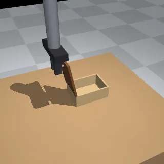

# One-demo suite (in-context imitation from one demonstration)

16 tasks in `tasks/one-demo/`, four families of four. Each task shows the agent one demonstration of a skill on one object, and asks for the same skill on a different object of the same family: open a hinged box, take a lid off a container, stand a full bottle up, pull a drawer open. The part the gripper touches (a knob, a cap or a handle) is the same on every object of a family; the object's size, shape, position and orientation are not, so the demonstration's numbers do not carry over to the agent's object, while its strategy does.

- Backend: the tabletop backend (`src/robouse/backends/tabletop/`). The families, their scenes and their reference strategies are in `onedemo.py`; the new parts (hinged boxes, drawer cabinets, lift-off lids, bottles) are in `scene.py`, with their observation fields and goals in `backend.py`.
- Generator: `python adapters/one-demo/generate.py` (writes `tasks/one-demo/<task-id>/`; `--frames DIR` also writes each demonstration's frames to look at).
- Reference solution: `python -m robouse.oracle --backend tabletop_onedemo --env <task-id>`, the family's strategy on the task's object.



## Inspiration and credit

The suite follows an idea from DemoMimic: "One Demonstration, Many Objects: Generalizing Manipulation via Local Contact Geometry", by Satvik Sharma, Samrat Sahoo, Huang Huang, Fei-Fei Li, Jiajun Wu, Dorsa Sadigh and Jeannette Bohg (Stanford; arXiv 2609.01938; <https://demomimic.github.io/>). DemoMimic learns dexterous manipulation from a single human demonstration and transfers it across 16 objects, four tasks (among them "open the box", "lift the lid" and "move the bottle") and two hands, because the local contact geometry, the shape of the object where the hand touches it, is preserved.

This suite takes only that framing: one demonstration, many objects, with the contact the same and the rest of the object different. It uses no code, data, models or assets from DemoMimic (its code is not released), and it tests something else: not a learned policy, but whether an agent that drives the robot through `robo` can read one demonstration and adapt it. The scenes, objects, strategies and scoring are Robo Use originals.

The name `one-demo` says what the agent gets: one demonstration per task. The `arc-style` suite also gives examples in context, but several of them, of a rule; here there is one, of a manipulation skill.

## What the agent gets

- The instruction (the task.md body): the scene, the goal and its success rule, and a section "One demonstration". That section carries the demonstration's `robo` commands, numbered, each followed by what `robo` printed for its reply (from command 2 on, a reply's `state` is cut down to the gripper and the parts of the demonstration's object that move), and a list saying which frame follows which command.
- The frames: when the episode starts, the episode server writes `observations/demo_1.png` to `observations/demo_N.png` (4 or 5 of them) into the agent's working directory, as the hard suite does with its rule pictures. Each frame shows one moment of the demonstration from the front and above, and from straight above with the gripper drawn see-through, with a caption naming the step and the command it follows.
- The agent's own object, in state mode: `robo observe` gives exact numbers for the gripper and the object, as in the other tabletop suites, including the contact point (`knob_pos`, `cap_pos` or `handle_pos`) and the geometry the strategy needs (`hinge_pos`, `base_pos`, `pull_direction`, `plug_depth` and so on).

The instruction does not describe the strategy in words; it tells the agent that its object is a different one, in another place, and to work out from the demonstration how the skill is done.

## How a demonstration is made

- Each family has one demonstration scene, with only the demonstration's object on the table, and one reference strategy (`STRATEGIES` in `onedemo.py`), which reads only the public observation.
- The generator runs the strategy on the demonstration scene in the episode server, in process: `Episode.handle`, the request handler and judge that `robouse serve` uses, without its video. It keeps every request, the reply to it, and the simulator state (`qpos`) at the moments the strategy marks as frames. It writes the family's tasks only if the demonstration scored 1.
- The trace in the instruction is those requests as `robo` command lines and the replies as `robo` prints them (`robouse.agent_cli.format_reply`). `robouse.scenario.demo` in task.md keeps the demonstration's scene, its requests (`commands`) and the frames' states (`frames`).
- The frames are rendered when an episode starts, from the stored states, in the demonstration's own scene (`TabletopBackend.workspace_images`, `demo_frames`). Nothing is simulated for them. Task folders hold no images; a frame is a PNG of 50 to 65 KB.
- A task's reference solution runs the same strategy on the task's own object, through the `robo` socket.
- The generator writes the same files on macOS (arm64) and on Linux (x86_64): both outputs were generated and compared, byte for byte.

## Families

| Family | Skill in the demonstration | Contact (the same on every object) | Demonstration's object | Success predicate | Budget |
|---|---|---|---|---|---|
| `open-box` | pinch the knob, swing it along its circle about the hinge until the lid is past upright, let go, slide the fingers off | a 2.4 cm ball knob on a stem near the lid's free edge | a 14 x 10 x 6 cm box hinged on the left | `lid_open`: lid open at least 100 degrees (it stops at 110), gripper not touching it | 900 |
| `lift-lid` | pinch the knob, lift straight up until the plug clears the rim, carry the lid over the pad, set it down, let go | a 2 cm cylindrical knob on the lid | a square tin 6 cm tall, its pad to the front left | `on_pad`: the lid's centre over the grey pad, resting on the table, tilted less than 15 degrees, released | 800 |
| `upright-bottle` | pinch the cap, swing it about the bottom edge of the base up to vertical, let go | a 2.4 cm ball cap | a 6 cm wide bottle with an 11 cm body, cap toward +x | `standing`: on its base on the table, tilted less than 10 degrees, at rest, released | 900 |
| `open-drawer` | lower the closed fingers into the gap behind the handle bar, pull along the slide to the stop, lift the fingers out | a bar handle 3.5 cm off the drawer's face | a cabinet facing the front, 10 cm of travel | `drawer` with `released`: open at least 75% of its travel, gripper not touching it | 600 |

The demonstrations take 268, 204, 278 and 116 steps, with 16, 12, 17 and 6 commands.

## Tasks

| Task | How its object differs from the demonstration's | Reference solution steps |
|---|---|---|
| `one-demo-box-mirrored` | hinge on the right, so the lid swings the other way; 2 cm shorter | 262 |
| `one-demo-box-tall` | a tall chest: hinge 7 cm higher, a 4 cm shorter lid, so a smaller circle | 244 |
| `one-demo-box-wide` | a wide flat case with the hinge on the right: a lid 8 cm longer, swinging the other way | 305 |
| `one-demo-box-small` | a small box near the front left corner: a lid 6 cm shorter, a lower hinge | 246 |
| `one-demo-lid-pot` | a round pot with a round lid; the pad lies the other way | 204 |
| `one-demo-lid-jar` | a narrow jar twice as tall, with a deeper plug; the pad straight in front of it | 214 |
| `one-demo-lid-tin` | a long, low tin; the pad to the front right | 201 |
| `one-demo-lid-dish` | a wide, shallow dish near the front; the pad behind it to the left | 212 |
| `one-demo-bottle-mirrored` | lies the other way round (cap toward -x) | 276 |
| `one-demo-bottle-tall` | 4 cm longer body: a larger circle | 294 |
| `one-demo-bottle-jug` | a short, wide jug lying the other way round | 266 |
| `one-demo-bottle-long-neck` | a neck three times as long (a larger circle), near the front left corner | 310 |
| `one-demo-drawer-left` | faces left: the drawer comes out toward -x | 116 |
| `one-demo-drawer-right` | a taller cabinet facing right, with a higher handle and 2 cm more travel | 116 |
| `one-demo-drawer-deep` | faces the front like the demonstration's, but low, with a lower handle and 6 cm more travel | 127 |
| `one-demo-drawer-small` | a small cabinet facing left, with 3 cm less travel | 124 |

## Controls

The generator checks four controls on every task before it writes it, each in a fresh episode, and refuses to write a task that fails one. Its output (2026-10-20, run on macOS and on Linux with the same result):

| Task | Reference solution | No-op | Demonstration copied | Copied, shifted to the contact |
|---|---|---|---|---|
| one-demo-box-mirrored | 1 (262 steps) | 0 | 0 | 0 |
| one-demo-box-tall | 1 (244 steps) | 0 | 0 | 0 |
| one-demo-box-wide | 1 (305 steps) | 0 | 0 | 0 |
| one-demo-box-small | 1 (246 steps) | 0 | 0 | 0 |
| one-demo-lid-pot | 1 (204 steps) | 0 | 0 | 0 |
| one-demo-lid-jar | 1 (214 steps) | 0 | 0 | 0 |
| one-demo-lid-tin | 1 (201 steps) | 0 | 0 | 0 |
| one-demo-lid-dish | 1 (212 steps) | 0 | 0 | 0 |
| one-demo-bottle-mirrored | 1 (276 steps) | 0 | 0 | 0 |
| one-demo-bottle-tall | 1 (294 steps) | 0 | 0 | 0 |
| one-demo-bottle-jug | 1 (266 steps) | 0 | 0 | 0 |
| one-demo-bottle-long-neck | 1 (310 steps) | 0 | 0 | 0 |
| one-demo-drawer-left | 1 (116 steps) | 0 | 0 | 0 |
| one-demo-drawer-right | 1 (116 steps) | 0 | 0 | 0 |
| one-demo-drawer-deep | 1 (127 steps) | 0 | 0 | 0 |
| one-demo-drawer-small | 1 (124 steps) | 0 | 0 | 0 |

- "Demonstration copied" replays the demonstration's motion commands (`move-to`, `grip`) verbatim on the task, then calls `robo done`. It scores 0 on every task: the demonstration does not give the task's answer away.
- "Copied, shifted to the contact" replays the same commands with every `move-to` target moved by the offset between the two objects' contact points (knob, cap or handle) at the start. It also scores 0 on every task: finding the matching contact on the new object is not enough, and the motion has to be adapted to it (the swing's direction and radius, the pull's direction and length, where the lid goes).
- `tests/test_onedemo.py` runs the same four controls from the task folders, and checks that endings that look close score 0: a lid let go before it is past upright (it falls shut), a lid held open, a drawer half open, a drawer open with the fingers still pulling on its handle, a lid set down beside its pad, and a bottle lifted by its cap. It also checks that each demonstration's recorded commands, run again on its own scene, reach the goal, that every command line in a trace is what `robo` would send, and that the frames render.

While choosing the objects, the reference strategies were also run with errors of the kind an imitation makes, on the demonstration's object and the four targets of each family. The bottles stood up with the swing in 15 or 20 degree steps instead of 10, with the pivot 1 cm off, and with the swing stopped at 85 or 95 degrees; the tall bottle failed with 30 degree steps. The boxes opened with the swing in 30 degree steps and with a circle 1 or 2 cm too large; a circle 1 cm too small failed on three of the five, 45 degree steps on one, stopping at 95 degrees on the small box, and stopping at 90 degrees on all five, since the lid has to pass upright to stay open. These runs were made with scratch scripts and are not part of the tests.

## Validation

`robouse tasks check` on every task, on Linux (x86_64, OSMesa), 2026-10-20: 16 of 16 valid. One of them:

```console
$ robouse tasks check tasks/one-demo/one-demo-box-wide
schema: ok (one-demo-box-wide, backend tabletop)
bench tasks check: skipped (BenchFlow is not installed)
reference solution: reward 1.0 (done, 305 steps)
no-op control: reward 0.0 (done)
valid
```

`robouse run-many` over the suite on the same machine: reference solution 16/16, no-op control 0/16. From a clean install of the wheel on macOS, `robouse run --task one-demo-bottle-mirrored --harness oracle` scored 1.0 (276 steps) and `--harness noop` 0.0, and the trial's `artifacts/observations/` held `demo_1.png` to `demo_5.png`.

The tabletop backend gained the new parts; the other tabletop suites' reference solutions and no-op controls, rerun after the change on the same machine, scored as before: libero-style 12/12 and 0/12, arc-style 11/11 and 0/11, robo-use-families 8/8 and 0/8, safety 8/8 and 0/8, hard 25/25 and 0/25, and the vision suite's 31 tabletop tasks 31/31 and 0/31 (its Meta-World tasks were not rerun: the tabletop change does not touch them).

## What the suite measures, and what it does not

It measures whether an agent can take a manipulation skill from one demonstration, given as frames and as a command trace, and do it on a different object: find the part of the new object that matches the demonstration's contact, and change the motion to fit the new object's geometry. The verdict is the episode server's, from the final physical state.

It does not measure:

- Whether the agent needs the demonstration. The goal is stated in words and the agent's own object is given as exact numbers, so a capable agent may solve some tasks without reading the demonstration. The same tasks without the demonstration (a no-demonstration ablation) are not built yet, so the suite cannot yet say how much the demonstration helps.
- Imitation from images alone. The frames are the only images, and the trace gives the demonstration as numbers too; an agent that cannot read images still has the trace. The agent's own object is never shown only in images (there is no vision variant).
- Learning in the training sense: nothing is learned across episodes; the demonstration is in context only.
- Dexterous hands, human demonstrations or several embodiments, as in DemoMimic. There is one robot, a floating parallel gripper that cannot rotate; the demonstration is a scripted controller's episode in the same simulator, so no retargeting from a human hand is involved; and "local contact geometry" here is a knob, a ball cap or a handle bar under two flat fingers, not a hand's fingertip contacts.
- Variety within a family beyond the four objects of each: layouts are fixed per task, and the seed does not move anything.

## Design notes and limitations

- The gripper cannot rotate and its fingers close along y, so hinges and bottles turn about horizontal y axes only: a box's hinge runs along its left or right top edge, and a bottle lies along x. A ball (the box's knob, the bottle's cap) pinched from above turns freely about the pinch axis: it has no torsional friction (`condim` 3) and its contact parameters take priority over the fingers'. That is what lets a held lid or bottle swing while the fingers stay level.
- The bottles are full, 0.8 kg each. Pinched by the cap, a bottle is tipped up about its base, which carries most of its weight, but cannot be lifted clear of the table: it slips out of the fingers. So the demonstrated tip-up is needed, rather than lifting the bottle by its cap and letting it hang straight. With light bottles (about 0.1 kg), that shortcut stood three of the first five bottles tried upright, and copying the demonstration shifted to the cap then worked on some targets; from 0.8 kg up it failed on all of them, and above 1.2 kg the tip-up began to fail.
- A hinged lid and a cabinet's drawer do not collide with their own box or cabinet, only with the gripper and objects, as the existing drawer does, so they cannot jam. The shut lid is held by its joint limit.
- `holding` lists free objects only, so it stays empty while the fingers hold a box's knob or a drawer's handle; the box and the cabinet report `gripper_touching` instead, and their success rule uses the same contact.
- The frames are rendered from stored simulator states. A change to the scene builder that changes the demonstration scene's state vector needs the tasks regenerated; the backend refuses a frame whose state does not fit its scene.
- As in the other tabletop suites, the scenario in task.md holds the goals and the demonstration's commands, and the reference strategies are in the package. The sandbox hides the task folder and the installed package from the agent, but public copies exist (see [Isolation](../run-agents.md#isolation)).

## Not done yet

- A no-demonstration ablation of the same 16 tasks, to measure what the demonstration adds.
- A vision variant, with the agent's own object only in camera images.
- The same families on the dexterous-hand backend (`dexhand`), closer to DemoMimic's setting; the tabletop gripper was used first because its tasks are sound and need no downloaded assets.
- Model runs: no agent has been run on the suite yet.
