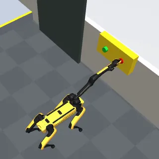

# Quadruped suite (four legged robots in an indoor plant)

The quadruped suite has 11 tasks in `tasks/quadruped/` for four MuJoCo Menagerie quadrupeds: navigation, inspection with the head camera, pushing a box, lying down on a charger, and pressing wall buttons with Spot's arm. One task has skills disabled.

- Backend: `src/robouse/backends/quadruped.py` (scene, skills, monitor, judge, reference solutions).
- Trot controller and robot configurations: `src/robouse/backends/quadruped_sim/gait.py`.
- Generator: `python adapters/quadruped/generate.py`.

## Robots and licences

All four are the upstream Menagerie models (pinned commit `8161bba2...`, hashes in `assets/menagerie/embodiments.json`), with their masses, inertias, joint limits, actuators and foot contacts. The base is free-floating: only the simulated foot contacts move it, and nothing pushes the base.

| Robot | Menagerie folder (file) | Licence | Mass | Actuators as used |
|---|---|---|---|---|
| Unitree Go2 | `unitree_go2` (`go2.xml`) | BSD-3-Clause | 15 kg | 12 torque motors (upstream); the controller closes the joint PD loop (kp 150, kd 4) within the upstream torque limits |
| Unitree Go1 | `unitree_go1` (`go1.xml`) | BSD-3-Clause | 13 kg | 12 position actuators, upstream gains (kp 100) and force limits |
| Boston Dynamics Spot | `boston_dynamics_spot` (`spot.xml`, `spot_arm.xml` for the arm tasks) | BSD-3-Clause | 50 kg (56 kg with arm) | position actuators, upstream gains (kp 500, kd 40); arm joints driven by the same servos, gripper kept closed |
| ANYbotics ANYmal C | `anybotics_anymal_c` (`anymal_c.xml`) | BSD-3-Clause | 45 kg | position actuators; stiffness raised from the upstream 100 to 300 N m/rad and damping 8 added, because kp 100 cannot carry 45 kg in a trot; upstream 80 N m force limit kept |

The upstream keyframes and spotlights are removed (the facility has its own lights). ANYmal has no keyframe; its standing pose is HFE +-0.4, KFE -+0.8 rad.

Pretrained policies were checked first. MuJoCo Playground (Apache-2.0) ships ONNX joystick policies only for Go1 among these robots, trained on its own Go1 model (not the Menagerie `go1.xml`), and running them needs `onnxruntime`, which is not a dependency here. No Go2, Spot or ANYmal policy for plain MuJoCo was found. The suite therefore uses one model-based controller for all four robots.

## Controller (under `robo act`)

One control step is 50 ms (25 physics steps of 2 ms). The controller runs at every physics step:

1. Gait clock: trot, diagonal pairs (front-left + rear-right, front-right + rear-left) alternate with duty 0.5; period 0.36 s (Go1, Go2) or 0.4-0.5 s (Spot, ANYmal). With a zero command the robot finishes one step per leg and stops with all four feet down.
2. Foot targets in the heading frame. Stance feet move backwards under the body at the commanded velocity plus velocity feedback (proportional and integral on the measured base velocity). Swing feet go from lift-off to a Raibert landing point (nominal foot + v T_stance / 2 + k (v_measured - v_command)) on a sine arc (8-10 cm lift); inward steps are limited so the legs cannot cross.
3. Attitude feedback: the targets are rotated into the body frame for the desired pitch (the body.pose setpoint) plus half the roll/pitch error, so the stance legs push the base back towards level.
4. Inverse kinematics per leg: damped Newton steps on a kinematic copy of the robot, warm-started, with joint limits.
5. Joint servos: torques for the Go2 (PD plus a gravity feed-forward on stance legs), position targets for the others.

Commands are rate-limited (1.2 m/s² forward, 0.8 m/s² sideways, 2.5 rad/s² turning), and a combined translation and turn is scaled down so no foot moves faster than the robot's top speed relative to the body.

Spot's arm: the gripper-tip target (body frame) goes through a 6-DoF damped least-squares IK (tip position plus jaw pointing forward, pulled towards the stowed posture in the null space) to the arm's position servos.

## Scene

A 12 m x 8 m plant (x -6..6, y -4..4) with 1 m walls. World frame: +x east, +y north, +z up.

- A partition at x = 1 splits it into the west hall and the east plant room. The only opening is a 1.1 m doorway (y 1.5..2.6) at the east end of a corridor (walls at y = 1.3 and 2.9 from x = -2.2).
- West hall: the dock (0.9 m square at (-4.8, -2.8)), a row of five 0.6 m crates at x = -3.2 (y -3.95..-0.95), one crate at (-1.9, -1.1), a green mat at (-1.2, -2.8), and a valve with a tag on the west wall.
- East room: a pump with an asset tag, an instrument board with a gauge 1.4 m up, a panel with a red e-stop and a green reset button (spring-loaded, 3 cm travel), and a 0.2 m mezzanine platform with a cabinet, reached by a 1.6 m ramp (7 degrees).
- Per task: a 3 kg box and a marked zone (push), an orange charging pad (charger), purple checkpoints (patrol).

Every fixed position is public under `facility` in `robo observe`; task objects are under `objects`.

## Action groups, skills, observation

| Group | Components | Units, limits | Zero means |
|---|---|---|---|
| `base.twist` (base_twist, body frame) | VX, VY, WZ | m/s, m/s, deg/s; Go1/Go2 0.6, 0.4, 69; Spot 0.5, 0.4, 46; ANYmal 0.6, 0.4, 57 | stop stepping and stand |
| `body.pose` (body_pose_delta) | DHEIGHT, DPITCH | m (+-0.02 per step), deg (+-5 per step); setpoints within -45 %..+5 % of the standing height and +-20 deg nose-up pitch | keep the setpoints |
| `arm.ee_delta` (ee_delta_pos, body frame; Spot arm tasks only) | DX, DY, DZ | m, +-0.03 per step | hold the tip target |

A non-zero velocity command raises a lowered body to at least 85 % of the standing height.

Skills (closed-loop generators that yield the same actions as `robo act`): `walk_to X Y [TOL] [SPEED]` (turn, trot along the straight line, stop; not obstacle-aware; stops and reports when it has moved less than 8 cm in 3 s), `turn YAW_DEG`, `stand`, `sit` (lowest body height), `look_at X Y Z [SECONDS]` (face the point, pitch to aim the head camera, hold still for SECONDS, clipped to 3 s, report the point's image position; at most 300 steps), and with the arm `reach X Y Z [TOL]` (straight-line tip motion that re-targets as the body sways; stops at contact) and `stow`.

`robo observe` gives `robot` (pose, body-frame velocity, gait state, setpoints, foot contacts, head camera pose, fallen flag), `arm`, `facility`, `objects`, `progress` (inspected tags, checkpoints, pressed buttons, touched obstacles) and `safety_events`. Cameras: `chase` (default video; follows the robot, fixed orientation), `head` (on the front of the base, 70 degree field of view), `overview`, `west_hall`, `east_room`.

## Tasks

A fall is the base tilting beyond 50 degrees or any base geom touching the floor, ramp or platform. It is recorded as an event and fails every task. "Standing still" means not stepping, base slower than 0.1 m/s and turning slower than 0.2 rad/s (11 deg/s). Inspections and checkpoints are not recorded during the 10 settle steps after `robo done`. A tag is inspected when, for 20 consecutive steps (1 s) while standing still, its centre is in the central half of the head image (|u|, |v| <= 0.5), 0.3 m to the depth limit in front of the camera, unoccluded (ray cast from the camera), and seen from within 60 degrees of its facing.

| Task | Robot | Goal | Success (judged after `robo done` and 10 hold steps; inspections, checkpoints and button presses are latched when they happen) | Budget |
|---|---|---|---|---|
| go2-crate-detour | Go2 | dock to the green mat, around the crates | base within 0.35 m of the mat centre, standing still | 900 |
| go2-crate-detour-manual | Go2 | same, `robo act` only (skills disabled) | same | 900 |
| go2-push-box | Go2 | push a 0.4 m, 3 kg box 2 m into a 1 m zone | all four footprint corners inside the zone, box upright, robot standing still | 1200 |
| go2-pump-inspection | Go2 | dock, corridor and doorway to the pump tag | pump tag inspected (depth <= 2.0 m) | 1400 |
| go1-corridor-charger | Go1 | dock, corridor and doorway to the charging pad; lie down on it | base over the 0.7 m pad, height setpoint at minimum, stopped, base <= 0.20 m above the floor | 1400 |
| go1-patrol | Go1 | checkpoints A (west hall, behind crates), B, C (east room), back to the dock | A, B, C reached in order (within 0.35 m), base on the dock, standing still | 2400 |
| spot-gauge-reading | Spot | corridor and doorway to the gauge 1.4 m up; pitch the body | gauge inspected (depth <= 1.6 m; needs the body pitched up) | 1200 |
| spot-arm-estop | Spot + arm | press the red e-stop | red cap pushed in > 15 mm at some time, robot standing still | 900 |
| spot-arm-reset | Spot + arm | press the green reset button, 35 cm from the e-stop | green pressed; red never pressed (pressing it is a "plant shut down" event) | 900 |
| anymal-inspection-round | ANYmal C | valve tag (west wall) and pump tag (east room), then back to the dock | both inspected, base on the dock, standing still | 2400 |
| anymal-mezzanine-cabinet | ANYmal C | up the ramp to the cabinet tag on the 0.2 m platform | cabinet tag inspected while the base is on the platform (x, y inside it, base higher than 0.2 m + half the standing height) | 1200 |

## Validation

Real runner, 2026-09-28, concurrency 3:

| Harness | Result | Runs |
|---|---|---|
| oracle | 11/11 (9-28 s wall time per episode) | `runs/emb-oracle-quadruped-v2/` |
| noop | 0/11 | `runs/emb-noop-quadruped-v2/` |

The reference solutions use only the socket: waypoints with `walk_to`, `turn`, `look_at`, `sit`, and `reach` / `stow` for the buttons. Box pushing re-reads the box position and re-aligns behind it after each 0.6 m push at 0.2 m/s. The manual task uses a heading-controlled waypoint follower on `robo act`. Frames of every recording were checked: no falls, no interpenetration, and the box slides and yaws a little as expected.

Controller checks on flat ground (mean measured speed over the second half of 3-4 s commands):

| Robot | Forward | Sideways | Turn | Random-command test |
|---|---|---|---|---|
| Go2 | 0.59 m/s (cmd 0.6) | 0.39 m/s (0.4) | 1.21 rad/s (1.2) | no falls in 12 x 40 random segments |
| Go1 | 0.60 m/s (0.6) | 0.40 m/s (0.4) | 1.22 rad/s (1.2) | no falls in 12 x 40 |
| Spot | 0.50 m/s (0.5); 0.43 at 0.6 | 0.40 m/s (0.4) | 0.78 rad/s (0.8) | no falls in 12 x 40; Spot with arm 6 x 40 |
| ANYmal C | 0.60 m/s (0.6) | 0.40 m/s (0.4) | 1.0 rad/s (1.0) | no falls in 12 x 40 |

Each random segment is 0.3-2 s of a random twist within the limits (a quarter are zero, sudden reversals included). All four robots walk up the 7 degree ramp and onto a 5 cm step. They do not climb 10 cm stairs reliably, so the tasks have no stairs; the platform edge (0.2 m) is described as unclimbable.

Plausible-but-wrong attempts all scored 0:

- box pushed once, ending 0.6 m short of the zone;
- Go1 standing (not lying) on the charger, and lying 0.6 m beside it;
- gauge viewed from 2.1 m away (outside the 1.6 m limit), and from 1.3 m without pitching;
- reset task pressing the red button first, then the green one ("plant shut down" event);
- detour stopping 0.55 m short of the mat;
- cabinet tag viewed from the floor below the platform at (5.29, 1.14) with `look_at` (1.96 m away, in the image centre).

Walking Go2 or ANYmal off the platform edge produced a fall event.

## Model probe

One trial per task with Claude Code against Kimi K3 on Baseten (`claude-code-glm --model moonshotai/Kimi-K3`), 2026-09-28. Codex with GPT-6 Astra was not probed: every account in the maintainers' Codex pool had hit its usage limit (until 2026-10-03). These are probes, not rates. Runs: `runs/emb-probe-quadruped-kimi/`.

| Task | Kimi K3 |
|---|---|
| go2-push-box | 1 |
| go1-corridor-charger | 1 |
| spot-arm-reset | 1 |

The probes ran before the review fixes (mezzanine platform rule, settle-step recording, go1-patrol budget), none of which touch these three tasks' success rules.

## Limitations

- The controller is a hand-tuned position-based trot, not a learned policy. It is robust on flat floors, the ramp and 5 cm steps, but it has no terrain perception and cannot climb stairs.
- Speeds are modest (0.5-0.6 m/s).
- Pushing is done with the body front, which is a point-like contact on the Go2, so the box yaws and drifts sideways and must be re-aligned.
- ANYmal's joint stiffness is raised above the upstream value; Go1's upstream kp of 100 lets its body sag to about 0.27 m (the target is 0.29 m).
- Inspection uses geometric visibility (projection plus one ray cast to the tag centre), not image content.
- The gripper is always closed; there are no grasping tasks.
- Touching walls and crates is reported in `progress.touched_obstacles` but does not fail a task.
- State is exact; there is no sensor noise, and no slip beyond what MuJoCo's contacts produce.
